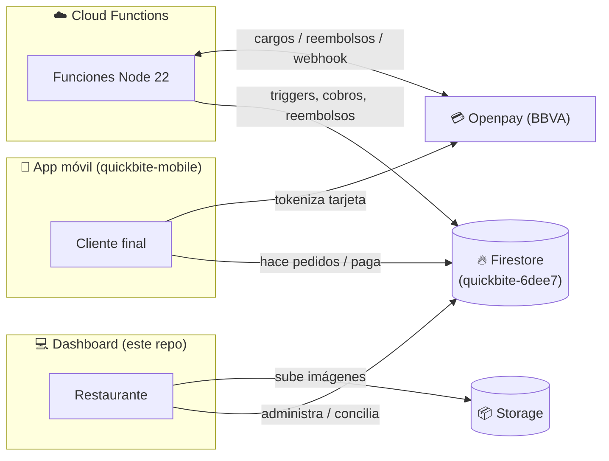
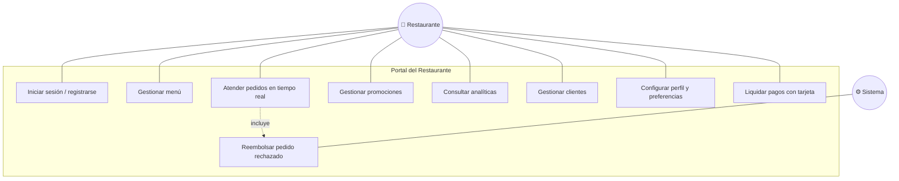
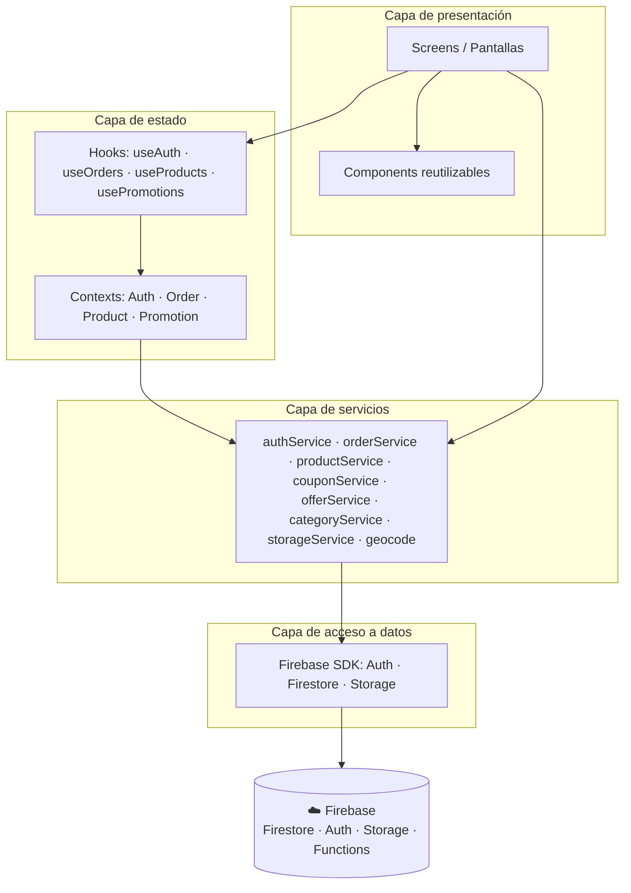
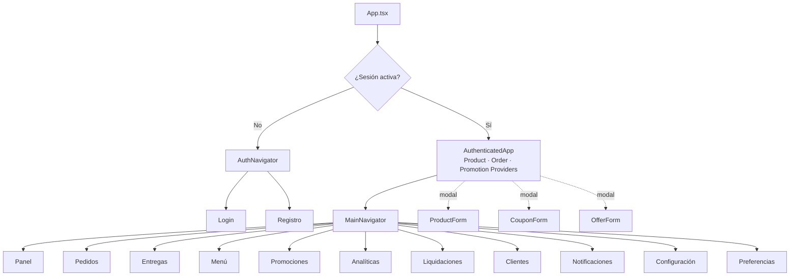
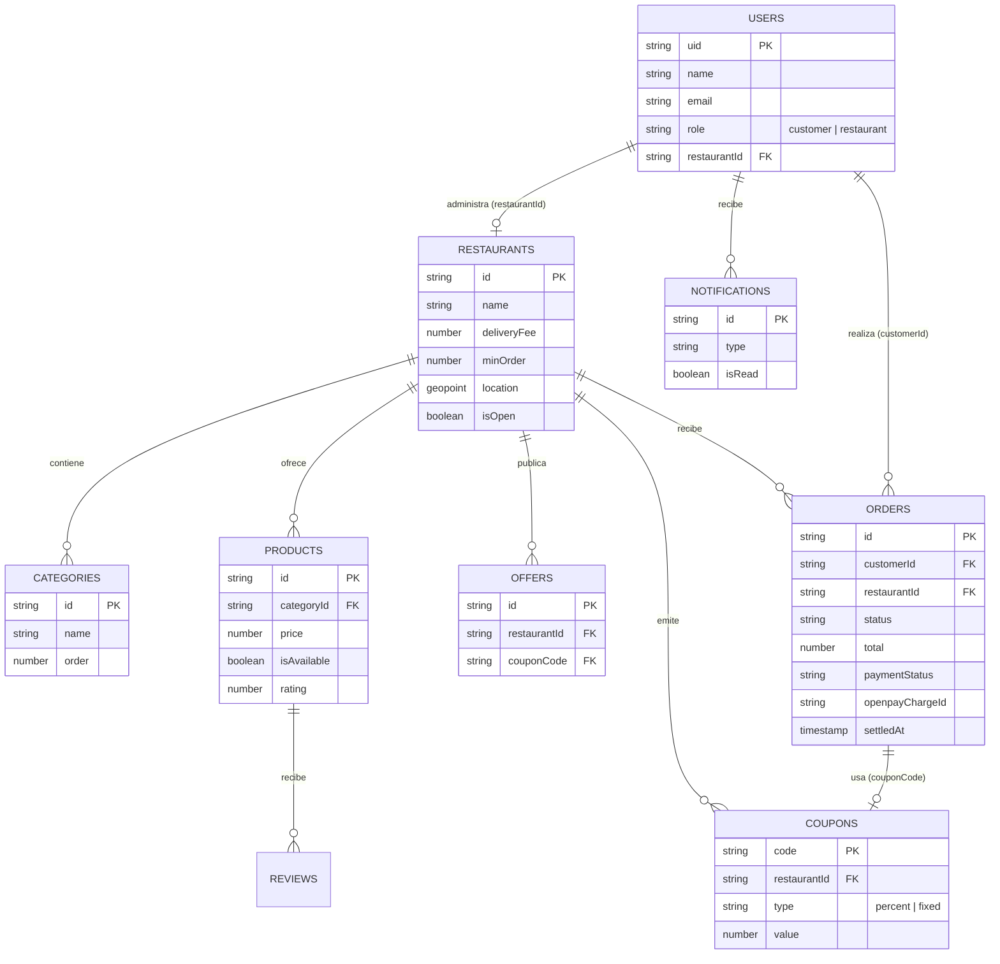
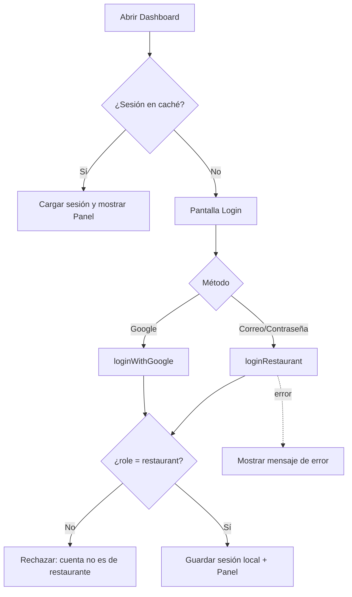
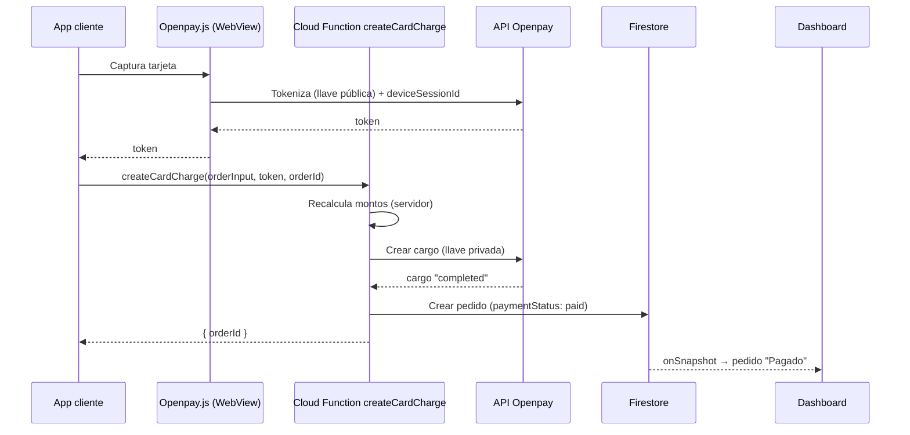
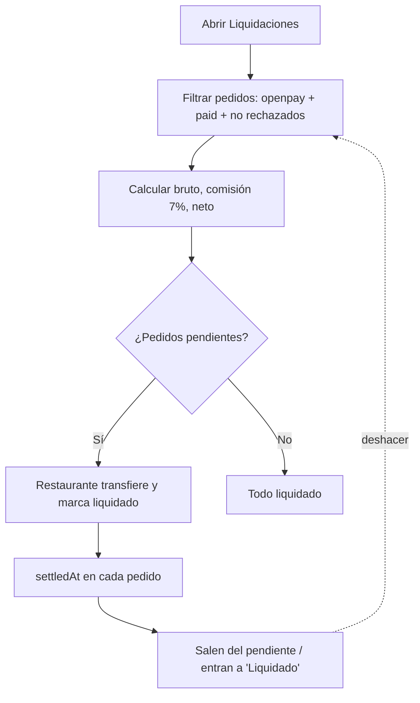
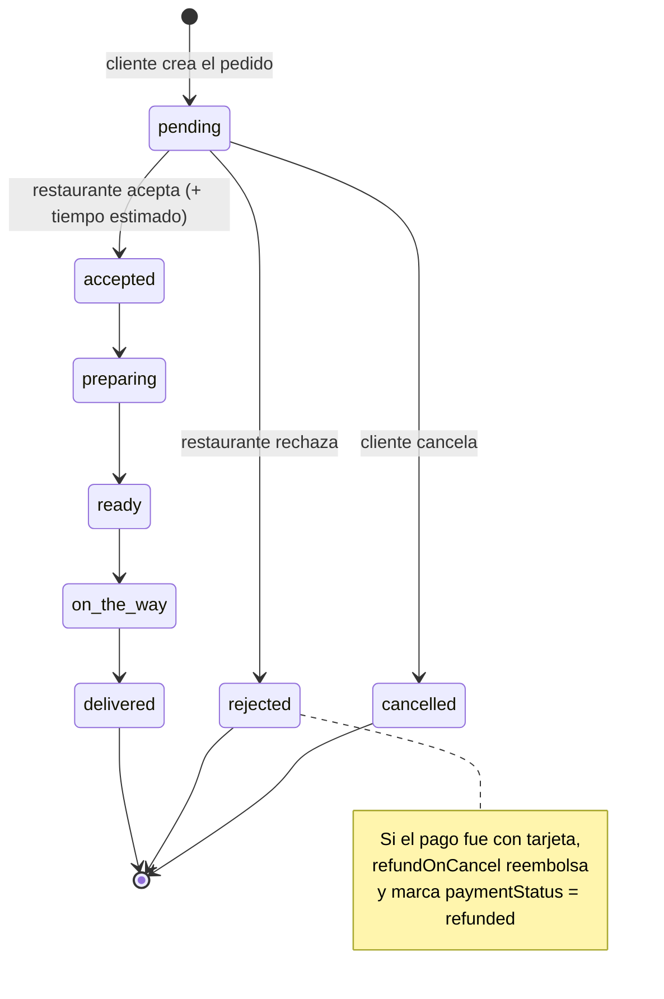

# QuickBite — Portal del Restaurante (Dashboard)
## Documentación técnica del software

| | |
|---|---|
| **Producto** | QuickBite — Merchant Portal (Dashboard web/escritorio del restaurante) |
| **Proyecto Firebase** | `quickbite-6dee7` |
| **Plataforma** | Expo 53 · React Native 0.79 · React Native Web · TypeScript |
| **Ecosistema** | Dashboard (este repo) + App móvil cliente (`quickbite-mobile`) + Cloud Functions |
| **Versión del documento** | 1.0 — 2026-07-26 |
| **Estado** | Funcional en entorno de pruebas (sandbox). Sin despliegue a producción. |

---

## Tabla de contenido

1. [Introducción](#1-introducción)
2. [Descripción general del sistema](#2-descripción-general-del-sistema)
3. [Objetivos](#3-objetivos)
4. [Actores del sistema](#4-actores-del-sistema)
5. [Requerimientos funcionales](#5-requerimientos-funcionales)
6. [Requerimientos no funcionales](#6-requerimientos-no-funcionales)
7. [Casos de uso](#7-casos-de-uso)
8. [Arquitectura de software](#8-arquitectura-de-software)
9. [Stack tecnológico](#9-stack-tecnológico)
10. [Estructura del proyecto](#10-estructura-del-proyecto)
11. [Mapa de navegación](#11-mapa-de-navegación)
12. [Modelo de datos (Base de datos)](#12-modelo-de-datos-base-de-datos)
13. [Diagramas de flujo](#13-diagramas-de-flujo)
14. [Ciclo de vida del pedido](#14-ciclo-de-vida-del-pedido)
15. [Integración de pagos (Openpay)](#15-integración-de-pagos-openpay)
16. [Seguridad](#16-seguridad)
17. [Gestión de estado](#17-gestión-de-estado)
18. [Capa de servicios](#18-capa-de-servicios)
19. [Componentes reutilizables](#19-componentes-reutilizables)
20. [Tema, modo oscuro y preferencias](#20-tema-modo-oscuro-y-preferencias)
21. [Instalación y despliegue](#21-instalación-y-despliegue)
22. [Glosario](#22-glosario)

---

## 1. Introducción

### 1.1 Propósito
Este documento describe de forma integral el **Portal del Restaurante (Dashboard)** de QuickBite: sus requerimientos, casos de uso, arquitectura, modelo de datos, flujos y decisiones de diseño. Sirve como referencia técnica para desarrollo, mantenimiento y evaluación académica.

### 1.2 Alcance
El Dashboard es la aplicación que usa el **restaurante** para administrar su operación: menú, pedidos en tiempo real, entregas, promociones, analíticas, clientes, configuración y **liquidaciones** (conciliación de pagos con tarjeta). No incluye la app del cliente final (proyecto `quickbite-mobile`), aunque ambos comparten la misma base de datos y backend, por lo que se documentan sus puntos de contacto.

### 1.3 Definiciones y acrónimos
- **Fonda:** restaurante local, típicamente familiar (contexto Michoacán).
- **CRUD:** Crear, Leer, Actualizar, Eliminar.
- **KPI:** Indicador clave de desempeño.
- **Liquidación:** transferencia del dinero (cobrado con tarjeta y retenido por la plataforma) al restaurante.
- **Openpay:** pasarela de pagos de BBVA México.
- **Security Rules:** reglas de autorización de Firestore.
- **onSnapshot:** suscripción en tiempo real de Firestore.

---

## 2. Descripción general del sistema

QuickBite es una plataforma de pedidos de comida a domicilio compuesta por tres piezas sobre un mismo proyecto Firebase:



- **App móvil:** el cliente explora restaurantes, arma el carrito, paga y sigue su pedido.
- **Dashboard:** el restaurante recibe y gestiona pedidos, administra su menú y promociones, ve analíticas y **concilia sus pagos**.
- **Cloud Functions:** lógica servidor de confianza (cobros con Openpay, reembolsos, notificaciones push, cálculo de reseñas). Reside en el repo `quickbite-mobile/functions` pero es transversal al proyecto.

---

## 3. Objetivos

### 3.1 Objetivo general
Proveer a los restaurantes una herramienta web profesional para operar su servicio de comida a domicilio de punta a punta, con foco en apoyar a fondas locales de Michoacán mediante una **comisión reducida del 7 %** (frente al ~15 % de competidores).

### 3.2 Objetivos específicos
- Gestionar pedidos **en tiempo real** con avisos de pedido nuevo.
- Administrar el menú (productos, categorías, disponibilidad, toppings, imágenes).
- Ofrecer analíticas accionables del negocio.
- Gestionar promociones (cupones y banners/ofertas).
- **Conciliar y liquidar** los pagos con tarjeta cobrados por la plataforma.
- Garantizar seguridad de datos y de pagos (la tarjeta nunca toca el servidor propio).

---

## 4. Actores del sistema

| Actor | Tipo | Descripción |
|---|---|---|
| **Restaurante** | Primario | Usuario autenticado con rol `restaurant`. Opera todo el dashboard sobre su propio `restaurantId`. |
| **Cliente final** | Externo | Genera pedidos y pagos desde la app móvil. No accede al dashboard; interactúa de forma indirecta a través de los datos. |
| **Sistema (Cloud Functions)** | Secundario | Actor automatizado: cobra, reembolsa, notifica y recalcula agregados. |
| **Openpay (BBVA)** | Externo | Pasarela de pagos que procesa cargos y reembolsos con tarjeta. |

---

## 5. Requerimientos funcionales

| ID | Módulo | Requerimiento |
|---|---|---|
| RF-01 | Autenticación | El restaurante puede iniciar sesión con correo/contraseña o con Google. |
| RF-02 | Autenticación | El registro crea la cuenta con rol `restaurant` y su documento `restaurants/{id}`. |
| RF-03 | Autenticación | La sesión persiste según la opción "recordar dispositivo". |
| RF-04 | Panel | Mostrar KPIs del negocio (ingresos, pedidos, ticket, tendencias). |
| RF-05 | Pedidos | Listar los pedidos del restaurante **en tiempo real**. |
| RF-06 | Pedidos | Notificar (toast + sonido) la llegada de un pedido nuevo. |
| RF-07 | Pedidos | Aceptar un pedido asignando tiempo estimado, o rechazarlo. |
| RF-08 | Pedidos | Avanzar el estado del pedido (aceptado → en cocina → listo → en camino → entregado). |
| RF-09 | Pedidos | Mostrar el estado de pago (Pagado / Pendiente / Reembolsado / Fallido) y la tarjeta usada. |
| RF-10 | Entregas | Ver los pedidos en reparto agrupados por estado. |
| RF-11 | Menú | CRUD de productos con imagen (subida a Storage), precio, disponibilidad, toppings y categoría. |
| RF-12 | Menú | CRUD de categorías con orden. |
| RF-13 | Analíticas | Ingresos por periodo, más vendidos, mapa de calor de horas pico y segmentos de clientes. |
| RF-14 | Analíticas | Exportar el reporte a CSV. |
| RF-15 | Clientes | CRM con segmentación (VIP, nuevo, en riesgo) y paginación. |
| RF-16 | Promociones | CRUD de cupones (porcentaje/fijo, mínimo, usos, vigencia). |
| RF-17 | Promociones | CRUD de ofertas/banners promocionales. |
| RF-18 | Notificaciones | Mostrar alertas derivadas de pedidos, stock y promos, agrupadas por día. |
| RF-19 | Configuración | Editar el perfil del restaurante, dirección con **geocodificación** y horario. |
| RF-20 | Preferencias | Configurar tema (claro/oscuro), sonido de pedidos y avisos emergentes. |
| RF-21 | Liquidaciones | Calcular por periodo lo cobrado con tarjeta, la comisión (7 %) y el neto a liquidar. |
| RF-22 | Liquidaciones | Marcar pedidos como liquidados y **deshacer** la liquidación. |
| RF-23 | Liquidaciones | Exportar el detalle de liquidaciones a CSV. |

---

## 6. Requerimientos no funcionales

| ID | Categoría | Requerimiento |
|---|---|---|
| RNF-01 | Usabilidad | UI responsiva: barra lateral fija (rail) en escritorio y cajón (drawer) en móvil/tablet. |
| RNF-02 | Usabilidad | Soporte de **modo claro/oscuro** en toda la aplicación. |
| RNF-03 | Rendimiento | Datos de pedidos en tiempo real vía `onSnapshot` (sin recarga manual). |
| RNF-04 | Seguridad | Autorización por rol mediante Firestore Security Rules; el restaurante solo accede a sus datos. |
| RNF-05 | Seguridad | La llave privada de Openpay reside solo en Secret Manager; la tarjeta nunca pasa por servidores propios. |
| RNF-06 | Confiabilidad | Cobro idempotente (sin doble cargo) y reembolso automático ante rechazo/cancelación. |
| RNF-07 | Disponibilidad | Backend serverless (Firebase) con escalado automático. |
| RNF-08 | Portabilidad | Base de código única Expo ejecutable en web y nativo. |
| RNF-09 | Mantenibilidad | TypeScript en modo estricto, arquitectura por capas y componentes reutilizables. |
| RNF-10 | Integridad | Los montos de cobro se recalculan en el servidor; nunca se confía en el cliente. |

---

## 7. Casos de uso

### 7.1 Diagrama de casos de uso



### 7.2 Fichas de casos de uso (principales)

#### CU-01 · Atender un pedido
| Campo | Detalle |
|---|---|
| **Actor** | Restaurante |
| **Precondición** | Sesión iniciada; existe un pedido en estado `pending`. |
| **Flujo principal** | 1. El sistema recibe el pedido y muestra toast + sonido. 2. El restaurante abre *Pedidos*. 3. Acepta el pedido y asigna tiempo estimado. 4. Avanza el estado conforme prepara y entrega. |
| **Flujo alterno** | 3a. El restaurante **rechaza** el pedido → si fue pagado con tarjeta, el sistema lo **reembolsa automáticamente** (CU-05). |
| **Postcondición** | El pedido queda en `delivered` (o `rejected`). El cliente recibe notificaciones de cada cambio. |

#### CU-02 · Gestionar el menú
| Campo | Detalle |
|---|---|
| **Actor** | Restaurante |
| **Precondición** | Sesión iniciada. |
| **Flujo principal** | 1. Abre *Menú*. 2. Crea/edita un producto (nombre, precio, categoría, toppings, disponibilidad). 3. Selecciona una imagen que se sube a Storage. 4. Guarda; el catálogo se refleja para el cliente. |
| **Postcondición** | `restaurants/{id}/products/{prodId}` creado/actualizado. |

#### CU-03 · Liquidar pagos con tarjeta
| Campo | Detalle |
|---|---|
| **Actor** | Restaurante |
| **Precondición** | Existen pedidos pagados con tarjeta (Openpay) no liquidados. |
| **Flujo principal** | 1. Abre *Liquidaciones*. 2. Selecciona periodo. 3. Revisa bruto cobrado, comisión (7 %) y neto a liquidar. 4. Tras transferir, marca los pedidos como **liquidados**. |
| **Flujo alterno** | 4a. Si marcó por error, usa **Deshacer** para revertir. |
| **Postcondición** | Los pedidos liquidados llevan `settledAt` y salen del pendiente. |

#### CU-04 · Configurar el restaurante
| Campo | Detalle |
|---|---|
| **Actor** | Restaurante |
| **Flujo principal** | 1. Abre *Configuración*. 2. Edita datos, dirección (se **geocodifica** a lat/lng), horario y portada. 3. Guarda. |
| **Postcondición** | `restaurants/{id}` actualizado; imágenes en Storage. |

#### CU-05 · Reembolso automático (Sistema)
| Campo | Detalle |
|---|---|
| **Actor** | Sistema (Cloud Function `refundOnCancel`) |
| **Disparador** | Un pedido pagado con tarjeta cambia a `rejected` o `cancelled`. |
| **Flujo** | 1. La función detecta el cambio. 2. Reembolsa el cargo en Openpay. 3. Marca el pedido `refunded`. 4. Notifica al cliente. |

---

## 8. Arquitectura de software

### 8.1 Estilo arquitectónico
Aplicación **cliente-servidor serverless** con arquitectura **por capas** en el frontend y backend **orientado a eventos** (Cloud Functions activadas por triggers de Firestore y llamadas callable/HTTP). El estado global se maneja con **React Context** (patrón Provider) y la lógica de datos se aísla en una **capa de servicios**.

### 8.2 Diagrama de capas (Dashboard)



### 8.3 Principios
- **Separación de responsabilidades:** las pantallas no llaman a Firestore directamente; usan servicios o contextos.
- **Fuente única de verdad de la sesión:** `AuthContext`.
- **Tiempo real por suscripción:** `OrderContext` escucha los pedidos con `onSnapshot`.
- **Seguridad de confianza cero en el cliente:** los montos de cobro se validan/recalculan en Cloud Functions.

---

## 9. Stack tecnológico

| Área | Tecnología |
|---|---|
| Framework | Expo 53, React Native 0.79, React Native Web 0.20 |
| Lenguaje | TypeScript 5.8 (estricto), React 19 |
| Navegación | React Navigation 7 (native-stack) |
| Backend as a Service | Firebase (Auth, Firestore, Storage), JS SDK 11 |
| Backend propio | Cloud Functions v2 (Node 22) — repo `quickbite-mobile/functions` |
| Pagos | Openpay (BBVA) vía REST desde Cloud Functions |
| Estado | React Context API |
| Persistencia local | AsyncStorage |
| Media | expo-image-picker, expo-image, Firebase Storage |
| Autenticación federada | expo-auth-session / Google |
| Geocodificación | Nominatim / OpenStreetMap (gratuito) |

---

## 10. Estructura del proyecto

```
quickbite-dashboard/
├── App.tsx                      # Punto de entrada (Providers + Navigator + Theme)
├── firebase.config.ts           # Credenciales Firebase (NO versionado)
├── firestore.rules              # Reglas de seguridad (sincronizadas con el móvil)
└── src/
    ├── components/               # UI reutilizable (MetricCard, Button, StatusBadge…)
    │   └── layout/               # ScreenShell, Sidebar (rail + drawer)
    ├── context/                  # AuthContext, OrderContext, ProductContext, PromotionContext
    ├── hooks/                    # useAuth, useOrders, useProducts, usePromotions
    ├── navigation/               # AppNavigator, AuthNavigator, MainNavigator, navigationRef
    ├── screens/
    │   ├── auth/                 # LoginScreen, RegisterScreen
    │   ├── dashboard/            # Home, Orders, Deliveries, Menu, Analytics,
    │   │                         # Liquidaciones, Customers, Notifications,
    │   │                         # Settings, Preferences, Promotions
    │   ├── menu/                 # ProductFormScreen (modal)
    │   └── promotions/           # CouponFormScreen, OfferFormScreen (modales)
    ├── services/                 # Capa de datos (Firestore/Storage/Auth)
    ├── types/                    # Modelos: user, restaurant, product, coupon, offer,
    │                             # order, notification, navigation
    └── utils/                    # theme, format, exportCsv, notify, confirm,
                                  # preferences, sessionStorage, sound, constants…
```

---

## 11. Mapa de navegación



La barra lateral (`Sidebar`) se renderiza como **rail fijo** cuando el ancho ≥ 960 px y como **drawer** deslizable en pantallas menores.

---

## 12. Modelo de datos (Base de datos)

Base de datos **NoSQL documental** (Cloud Firestore). Las relaciones se expresan por referencias de ID (no hay JOINs).

### 12.1 Diagrama entidad-relación



### 12.2 Diccionario de datos (colecciones principales)

**`users/{uid}`** — perfil de cliente o restaurante.
| Campo | Tipo | Notas |
|---|---|---|
| uid | string | = auth.uid |
| name, email | string | — |
| phone, photoURL | string? | opcionales |
| role | `customer` \| `restaurant` | define permisos |
| restaurantId | string? | solo si role = restaurant → FK a `restaurants` |

**`restaurants/{id}`** — datos del negocio.
| Campo | Tipo | Notas |
|---|---|---|
| name, description | string | — |
| cuisineTypes | string[] | tipos de cocina |
| coverImage, logoImage | string | URLs de Storage |
| deliveryFee, minOrder | number | usados en el checkout |
| location | GeoPoint | geocodificado desde la dirección |
| isOpen | boolean | disponibilidad |
| schedule | WeekSchedule | horario por día |

**`restaurants/{id}/products/{prodId}`** — platillos.
| Campo | Tipo | Notas |
|---|---|---|
| categoryId | string | FK a categories |
| price | number | precio unitario |
| isAvailable | boolean | visible al cliente |
| toppings | Topping[] | grupos de opciones |
| rating, reviewCount | number | calculado por Cloud Function (solo lectura) |

**`orders/{orderId}`** — pedidos (núcleo transaccional).
| Campo | Tipo | Notas |
|---|---|---|
| customerId, restaurantId | string | FKs |
| items | OrderItem[] | líneas del pedido |
| subtotal, deliveryFee, discount, total | number | recalculados en servidor al pagar |
| status | OrderStatus | ver §14 |
| paymentMethod | `card` \| `cash` | (`paypal` deshabilitado) |
| paymentStatus | `paid` \| `pending` \| `failed` \| `refunded` | — |
| paymentProvider | `openpay`? | solo tarjeta |
| openpayChargeId | string? | id del cargo |
| cardBrand, cardLast4 | string? | para mostrar |
| paidAt, refundedAt, settledAt | timestamp? | pago / reembolso / liquidación |
| couponCode | string? | FK a coupons |

**`coupons/{code}`** — el código es el ID del documento.
| Campo | Tipo | Notas |
|---|---|---|
| restaurantId | string | dueño; el cupón solo aplica aquí |
| type | `percent` \| `fixed` | — |
| value, minOrder, maxUses, usedCount | number | — |
| expiresAt | Date \| null | null = sin vencimiento |

**`offers/{offerId}`** — banners promocionales del Home móvil.
**`users/{uid}/notifications/{notifId}`** — bandeja de notificaciones (las crea Cloud Functions).

---

## 13. Diagramas de flujo

### 13.1 Inicio de sesión



### 13.2 Cobro con tarjeta (secuencia)



### 13.3 Liquidación de pagos



---

## 14. Ciclo de vida del pedido



El **estado de pago** (`paymentStatus`) es independiente del estado del pedido (`status`): un pedido puede estar `pending`/`delivered` con pago `paid`, o `rejected` con pago `refunded`.

---

## 15. Integración de pagos (Openpay)

El Dashboard **no cobra**: el cobro ocurre en la app cliente y en Cloud Functions. El Dashboard **lee y concilia**.

### 15.1 Modelo elegido
**Single-merchant "diseñado para crecer":** la plataforma cobra todos los pagos a su comercio Openpay y **liquida manualmente** a cada restaurante (módulo *Liquidaciones*). El modelo de datos reserva `openpayMerchantId` por restaurante para migrar a split/cuentas propias sin rehacer el flujo.

### 15.2 Componentes servidor (Cloud Functions)
| Función | Tipo | Rol |
|---|---|---|
| `createCardCharge` | callable | Recalcula montos, cobra en Openpay (idempotente) y crea el pedido pagado. |
| `openpayWebhook` | HTTP | Reconcilia `paymentStatus` con eventos asíncronos (reembolsos, contracargos). |
| `refundOnCancel` | trigger Firestore | Reembolsa automáticamente al rechazar/cancelar un pedido pagado. |

### 15.3 Garantías
- **PCI:** la tarjeta se tokeniza contra Openpay; nunca toca servidores propios.
- **Anti-doble-cobro:** `orderId` estable por intento; si el pedido ya está pagado, se devuelve sin recobrar.
- **Anti-manipulación:** el importe a cobrar se recalcula íntegro en el servidor.
- **Comisión:** 7 % configurable (`PLATFORM_COMMISSION_RATE`).

---

## 16. Seguridad

### 16.1 Autenticación y autorización
- **Firebase Authentication** (correo/contraseña y Google).
- Autorización por rol vía **Firestore Security Rules**: el rol `restaurant` solo puede administrar el `restaurantId` que le fue asignado; el cliente solo lee catálogo y gestiona sus propios pedidos.

### 16.2 Reglas por colección (resumen)
| Colección | Lectura | Escritura |
|---|---|---|
| `users/{uid}` | dueño | dueño (campos limitados) |
| `restaurants/{id}` | autenticados | solo el dueño |
| `products` / `categories` | autenticados | solo el dueño |
| `orders` | cliente dueño o restaurante receptor | cliente crea `pending` (nunca `paid`); restaurante avanza estado y marca `settledAt` |
| `coupons` | autenticados | dueño; cliente solo incrementa `usedCount` en 1 |
| `notifications` | dueño | las crea Cloud Functions (Admin SDK) |

### 16.3 Gestión de secretos
- Llaves **públicas** de Firebase/Openpay: en el cliente (seguras por diseño).
- Llave **privada** de Openpay y credenciales del webhook: solo en **Secret Manager** (Cloud Functions).

---

## 17. Gestión de estado

| Context | Responsabilidad |
|---|---|
| **AuthContext** | Sesión (usuario + restaurante), login/registro/logout, actualización de perfil, manejo de errores visible. |
| **OrderContext** | Suscripción en tiempo real a los pedidos del restaurante; detección de pedido nuevo → toast + sonido. |
| **ProductContext** | Catálogo (productos y categorías) del restaurante. |
| **PromotionContext** | Cupones y ofertas del restaurante. |

Cada contexto se consume mediante su hook (`useAuth`, `useOrders`, `useProducts`, `usePromotions`) que valida que se use dentro de su Provider.

---

## 18. Capa de servicios

| Servicio | Responsabilidad |
|---|---|
| `authService` | Login/registro de restaurante, Google, carga de sesión, actualización de perfil. |
| `orderService` | Consulta y escucha en tiempo real de pedidos; avanzar estado; `markOrdersSettled` / `unmarkOrdersSettled`. |
| `productService` | CRUD de productos. |
| `categoryService` | CRUD de categorías. |
| `couponService` | CRUD de cupones. |
| `offerService` | CRUD de ofertas/banners. |
| `storageService` | Subida de imágenes (logo, portada, productos) a Firebase Storage. |
| `geocode` | Geocodificación de direcciones (Nominatim/OpenStreetMap). |
| `firebase` | Inicialización del SDK (Auth, Firestore, Storage). |

---

## 19. Componentes reutilizables

Diseño consistente basado en un sistema de tokens (`utils/theme.ts`).

| Componente | Uso |
|---|---|
| `MetricCard` | Tarjeta KPI con ícono, tendencia y variantes. |
| `SectionCard` | Contenedor de sección con título/subtítulo. |
| `StatusBadge` | Insignia de estado del pedido. |
| `Button` | Botón (primario, outline, danger, ghost) con estado de carga. |
| `InputField` | Campo de formulario con foco y validación visual. |
| `MiniBarChart` / `HeatMap` | Visualizaciones de analíticas. |
| `ProductCard` / `CouponCard` / `OfferCard` | Tarjetas de dominio. |
| `Sidebar` (rail/drawer) · `ScreenShell` | Layout y navegación. |
| `ToastHost` | Sistema de avisos (pub/sub) compatible con web. |
| `LoadingOverlay` | Pantalla de carga. |

---

## 20. Tema, modo oscuro y preferencias

- **Tema por variables CSS:** cada color en `theme.ts` es una `var(--qb-*)` con paletas clara/oscura; `applyTheme(mode)` reescribe las variables en `document.documentElement`. Los componentes no cambian: siguen importando `colors`.
- **Preferencias** (`utils/preferences.ts`): pub/sub + AsyncStorage; controla tema, sonido de pedidos y avisos emergentes.
- **Avisos** (`utils/notify.ts` + `ToastHost`): reemplazan a `Alert.alert`, que no funciona en React Native Web.
- **Exportación** (`utils/exportCsv.ts`): genera y descarga CSV real (analíticas y liquidaciones).

---

## 21. Instalación y despliegue

### 21.1 Requisitos
- Node.js 20+, npm, Expo CLI.
- Proyecto Firebase `quickbite-6dee7` (plan Blaze para Cloud Functions).

### 21.2 Configuración
1. Copiar `firebase.config.example.ts` → `firebase.config.ts` con las credenciales web.
2. Instalar dependencias: `npm install`.

### 21.3 Ejecución (desarrollo)
```bash
npm run web      # Dashboard en el navegador
npm run start    # Expo dev server
```

### 21.4 Despliegue de reglas y funciones
Las reglas de Firestore y las Cloud Functions se despliegan desde el repositorio `quickbite-mobile` (fuente de verdad compartida):
```bash
firebase deploy --only functions,firestore:rules
```

---

## 22. Glosario

| Término | Definición |
|---|---|
| **Callable** | Cloud Function invocada de forma autenticada desde el cliente. |
| **Trigger** | Cloud Function que se ejecuta ante un evento de Firestore. |
| **GeoPoint** | Tipo de Firestore para coordenadas (lat/lng). |
| **Rail / Drawer** | Barra lateral fija (escritorio) / cajón deslizable (móvil). |
| **Liquidación** | Pago de la plataforma al restaurante por lo cobrado con tarjeta. |
| **Idempotencia** | Propiedad de que repetir una operación no cause efectos duplicados (evita doble cobro). |
| **Tokenización** | Conversión de los datos de tarjeta en un token seguro (Openpay), sin exponer el número real. |

---

*Documento generado para el Portal del Restaurante de QuickBite. Sistema en entorno de pruebas (sandbox); no desplegado a producción.*
