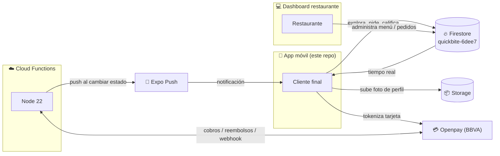
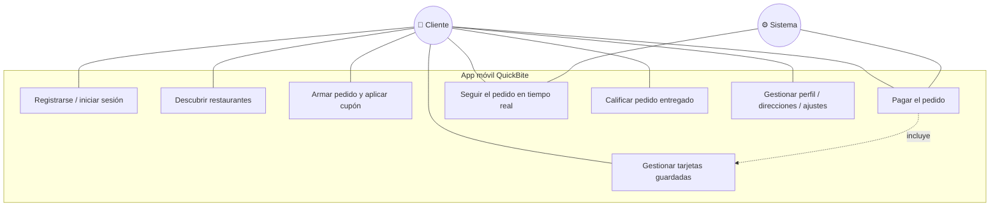
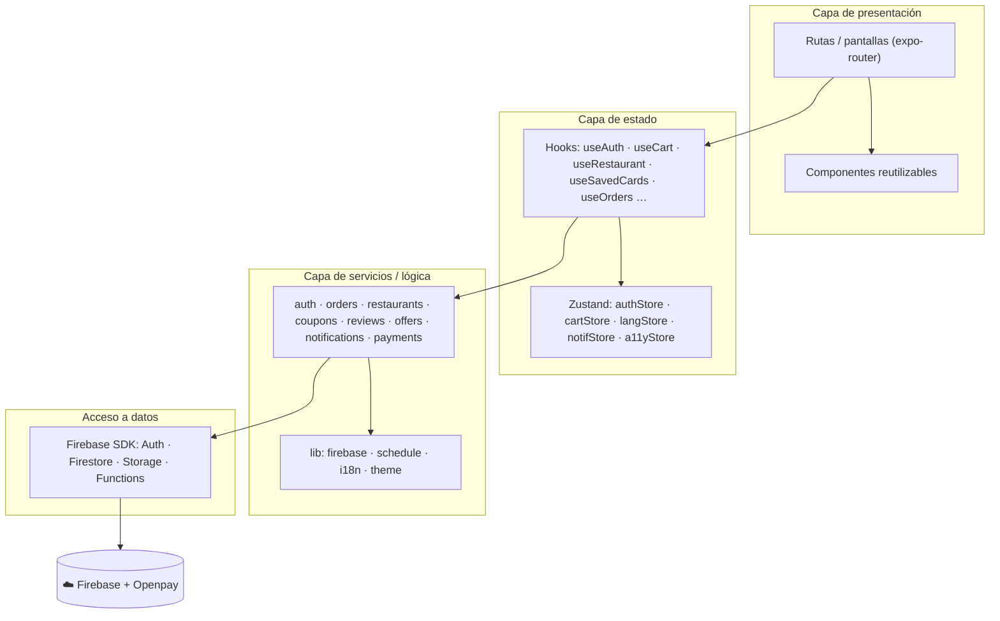
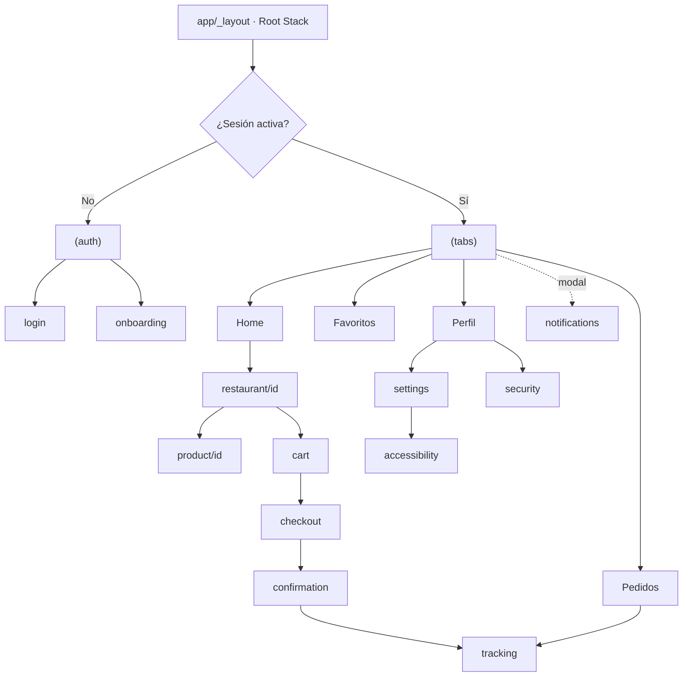
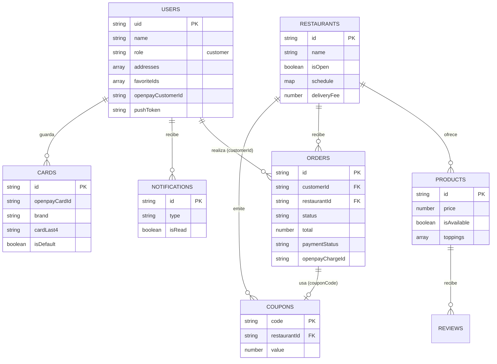
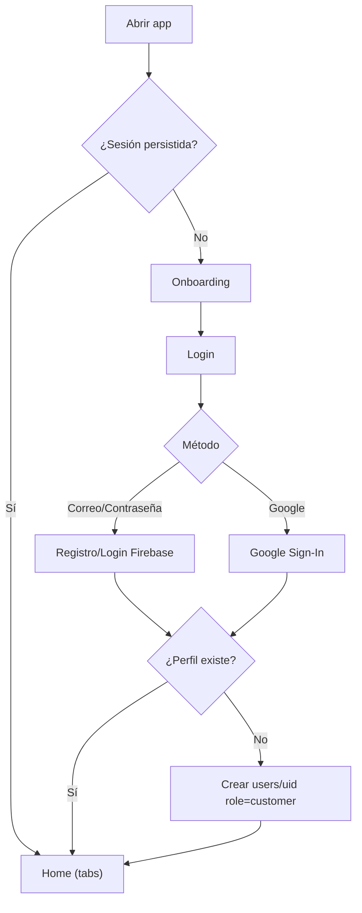
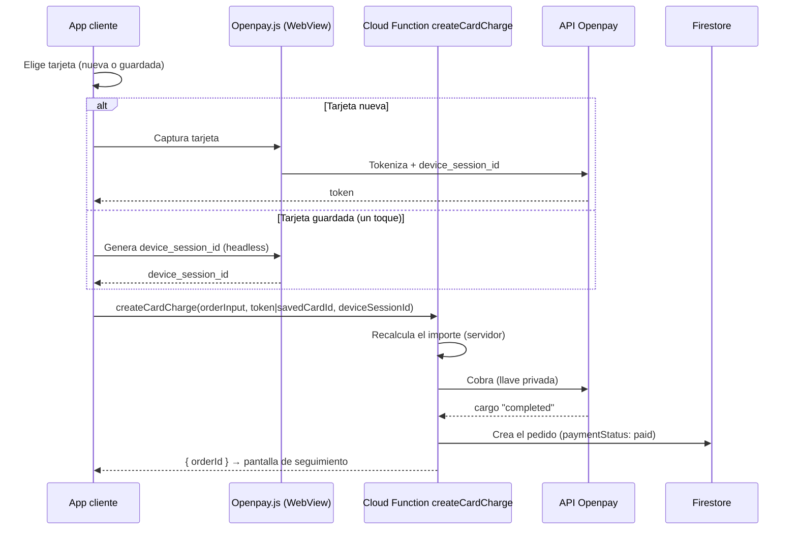
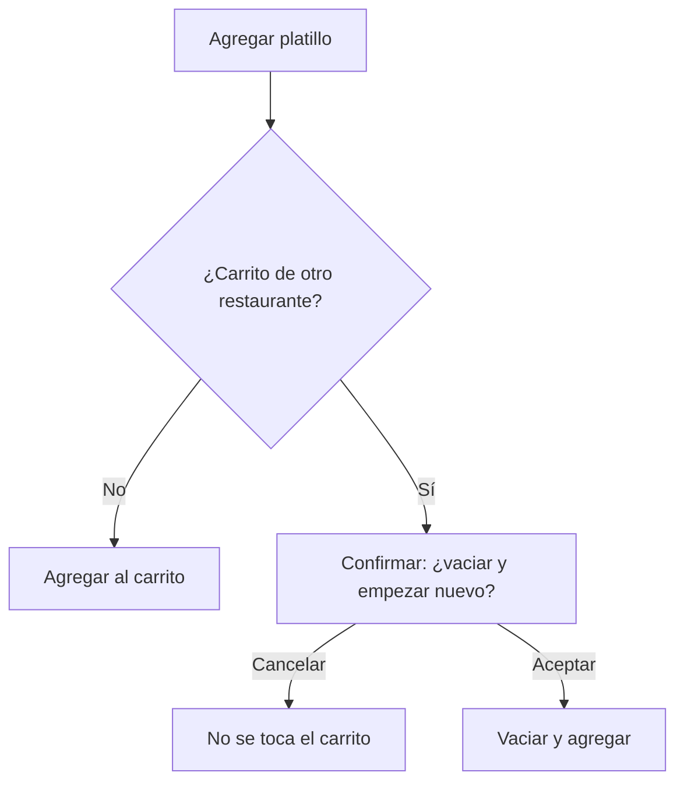
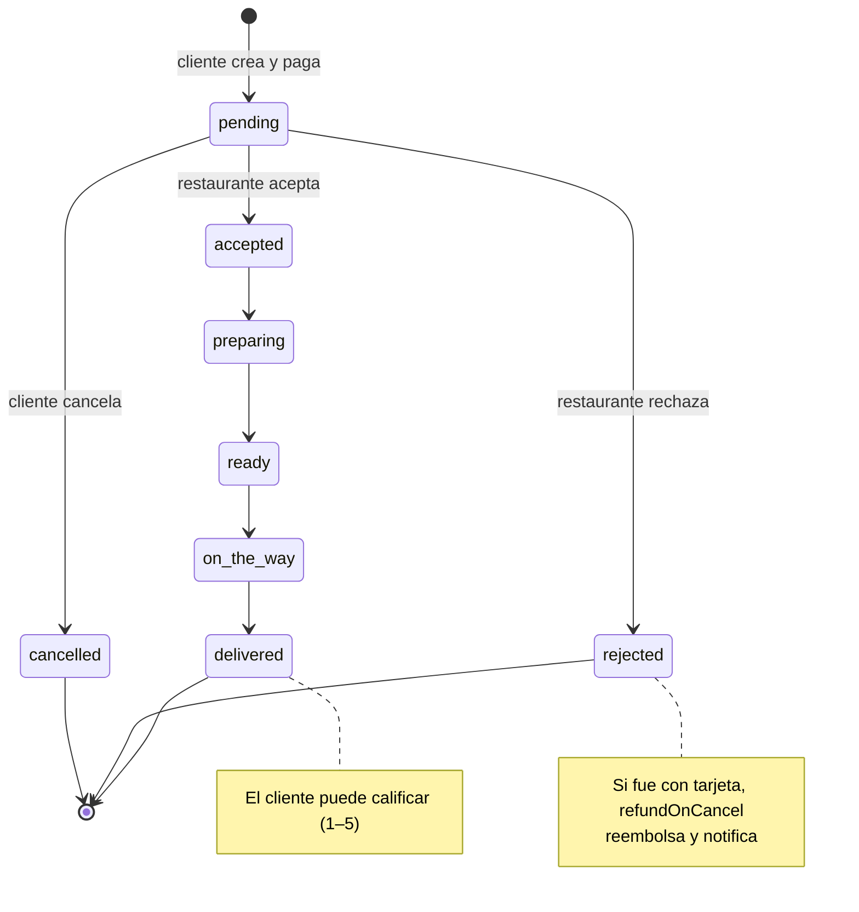

# QuickBite — App Móvil (Cliente)
## Documentación técnica del software

| | |
|---|---|
| **Producto** | QuickBite — App móvil del cliente (pedidos de comida a domicilio) |
| **Proyecto Firebase** | `quickbite-6dee7` |
| **Plataforma** | Expo 54 · React Native 0.81 · expo-router · NativeWind · TypeScript |
| **Ecosistema** | App móvil (este repo) + Dashboard del restaurante (`quickbite-dashboard`) + Cloud Functions |
| **Versión del documento** | 1.0 — 2026-08-11 |
| **Estado** | Funcional en entorno de pruebas (sandbox de pagos). Sin despliegue a producción. |

---

## Tabla de contenido

1. [Introducción](#1-introducción)
2. [Descripción general del sistema](#2-descripción-general-del-sistema)
3. [Objetivos](#3-objetivos)
4. [Actores del sistema](#4-actores-del-sistema)
5. [Requerimientos funcionales](#5-requerimientos-funcionales)
6. [Requerimientos no funcionales](#6-requerimientos-no-funcionales)
7. [Casos de uso](#7-casos-de-uso)
8. [Arquitectura de software](#8-arquitectura-de-software)
9. [Stack tecnológico](#9-stack-tecnológico)
10. [Estructura del proyecto](#10-estructura-del-proyecto)
11. [Mapa de navegación](#11-mapa-de-navegación)
12. [Modelo de datos (Base de datos)](#12-modelo-de-datos-base-de-datos)
13. [Diagramas de flujo](#13-diagramas-de-flujo)
14. [Ciclo de vida del pedido](#14-ciclo-de-vida-del-pedido)
15. [Pagos (Openpay)](#15-pagos-openpay)
16. [Notificaciones](#16-notificaciones)
17. [Estado del restaurante (abierto/cerrado)](#17-estado-del-restaurante-abiertocerrado)
18. [Seguridad](#18-seguridad)
19. [Gestión de estado](#19-gestión-de-estado)
20. [Capa de servicios](#20-capa-de-servicios)
21. [Internacionalización, tema y accesibilidad](#21-internacionalización-tema-y-accesibilidad)
22. [Instalación y despliegue](#22-instalación-y-despliegue)
23. [Glosario](#23-glosario)

---

## 1. Introducción

### 1.1 Propósito
Este documento describe de forma integral la **app móvil del cliente** de QuickBite: requerimientos, casos de uso, arquitectura, modelo de datos, flujos y decisiones de diseño. Es la referencia técnica para desarrollo, mantenimiento y evaluación académica.

### 1.2 Alcance
La app móvil es la que usa el **cliente final** para descubrir restaurantes, armar su pedido, pagar (tarjeta o efectivo), seguir la entrega en tiempo real y calificar. No incluye el panel del restaurante (`quickbite-dashboard`), aunque ambos comparten la misma base de datos y backend; sus puntos de contacto se documentan aquí.

### 1.3 Definiciones y acrónimos
- **Expo Router:** navegación basada en archivos (cada archivo en `app/` es una ruta).
- **NativeWind:** Tailwind CSS para React Native (estilos con `className`).
- **Zustand:** librería ligera de estado global.
- **Tokenización:** conversión de los datos de tarjeta en un token seguro (Openpay), sin exponer el número real.
- **Dev build:** compilación nativa personalizada de Expo (necesaria por los módulos nativos).
- **onSnapshot:** suscripción en tiempo real de Firestore.

---

## 2. Descripción general del sistema

QuickBite es una plataforma de pedidos de comida compuesta por tres piezas sobre un mismo proyecto Firebase:



- **App móvil (cliente):** descubrir restaurantes, carrito, pago, seguimiento y reseñas.
- **Dashboard (restaurante):** recibe/gestiona pedidos, menú, promociones y liquida sus pagos.
- **Cloud Functions:** lógica de confianza (cobros con Openpay, reembolsos, push, cálculo de reseñas). Vive en `functions/` de este repo pero es transversal.

---

## 3. Objetivos

### 3.1 Objetivo general
Ofrecer al cliente una app rápida y confiable para pedir comida a domicilio de fondas y restaurantes locales de Michoacán, con pago seguro con tarjeta y seguimiento en tiempo real.

### 3.2 Objetivos específicos
- Descubrir restaurantes y platillos con búsqueda y favoritos.
- Armar el pedido con personalización (toppings, notas) y cupones.
- Pagar con **tarjeta** (Openpay, con opción de **guardarla** para la próxima compra) o **efectivo** contra entrega.
- **Seguir el pedido en tiempo real** y recibir notificaciones push.
- Calificar el pedido entregado.
- Ser accesible (modo oscuro, alto contraste, texto grande) y bilingüe (es/en).

---

## 4. Actores del sistema

| Actor | Tipo | Descripción |
|---|---|---|
| **Cliente final** | Primario | Usuario autenticado con rol `customer`. Descubre, pide, paga, sigue y califica. |
| **Restaurante** | Externo | Gestiona el menú y el estado de los pedidos desde el dashboard; el cliente lo percibe de forma indirecta (menú, estado abierto/cerrado, avance del pedido). |
| **Sistema (Cloud Functions)** | Secundario | Actor automatizado: cobra, reembolsa, envía push y recalcula agregados. |
| **Openpay (BBVA)** | Externo | Pasarela de pagos y bóveda de tarjetas. |

---

## 5. Requerimientos funcionales

| ID | Módulo | Requerimiento |
|---|---|---|
| RF-01 | Autenticación | Registro e inicio de sesión con correo/contraseña o Google. |
| RF-02 | Autenticación | Onboarding inicial y sesión persistida en el dispositivo. |
| RF-03 | Descubrimiento | Home con restaurantes abiertos, filtro por tipo de cocina y búsqueda de restaurantes y platillos. |
| RF-04 | Descubrimiento | Marcar restaurantes y platillos como favoritos. |
| RF-05 | Restaurante | Ver el menú, calificación, horario y **estado abierto/cerrado en tiempo real**. |
| RF-06 | Producto | Personalizar el platillo (toppings, notas) y cantidad. |
| RF-07 | Carrito | Un pedido es de un solo restaurante (con confirmación al cambiar). |
| RF-08 | Carrito | Aplicar cupón válido del restaurante. |
| RF-09 | Checkout | Elegir dirección de entrega, método de pago e instrucciones. |
| RF-10 | Pago | Pagar con **tarjeta** (Openpay); opción de **guardar** la tarjeta. |
| RF-11 | Pago | Pagar con una **tarjeta guardada** en un toque; o en **efectivo** contra entrega. |
| RF-12 | Pago | Gestionar tarjetas guardadas (listar, agregar, eliminar). |
| RF-13 | Seguimiento | Ver el estado del pedido **en tiempo real** (confirmado → cocina → en camino → entregado). |
| RF-14 | Seguimiento | Cancelar el pedido mientras sigue `pending`. |
| RF-15 | Pedidos | Historial (activos, completados, cancelados) y **reordenar**. |
| RF-16 | Reseñas | Calificar (1–5) un pedido entregado (compra verificada). |
| RF-17 | Direcciones | Gestionar direcciones de entrega (con geolocalización). |
| RF-18 | Notificaciones | Recibir push e in-app (estado del pedido, promos, sistema) y marcarlas leídas. |
| RF-19 | Perfil | Editar perfil (nombre, teléfono, foto) y ver estadísticas. |
| RF-20 | Ajustes | Cambiar idioma (es/en) y preferencia de notificaciones; ayuda/FAQ. |
| RF-21 | Accesibilidad | Alto contraste y texto grande; modo oscuro. |
| RF-22 | Bloqueo | Si el restaurante está cerrado, la app impide pedir y lo informa. |

---

## 6. Requerimientos no funcionales

| ID | Categoría | Requerimiento |
|---|---|---|
| RNF-01 | Usabilidad | Interfaz bilingüe (español/inglés) y modo claro/oscuro. |
| RNF-02 | Accesibilidad | Alto contraste y escala de texto configurables por dispositivo. |
| RNF-03 | Rendimiento | Datos en tiempo real vía `onSnapshot` (restaurante, pedido, tarjetas, notificaciones). |
| RNF-04 | Seguridad | Autorización por rol (Firestore Rules); la tarjeta se tokeniza y nunca toca servidores propios (PCI). |
| RNF-05 | Confiabilidad | Cobro idempotente (sin doble cargo) y reembolso automático al rechazar/cancelar. |
| RNF-06 | Portabilidad | Base de código única Expo para Android e iOS (dev build). |
| RNF-07 | Persistencia | Sesión y preferencias (idioma, notificaciones, accesibilidad) en AsyncStorage. |
| RNF-08 | Integridad | Los montos a cobrar se recalculan en el servidor; nunca se confía en el cliente. |
| RNF-09 | Comunicación | Notificaciones push (Expo/FCM) para el avance del pedido y promos. |

---

## 7. Casos de uso

### 7.1 Diagrama de casos de uso



### 7.2 Fichas de casos de uso (principales)

#### CU-01 · Pedir y pagar con tarjeta
| Campo | Detalle |
|---|---|
| **Actor** | Cliente |
| **Precondición** | Sesión iniciada; restaurante **abierto**; hay una dirección de entrega. |
| **Flujo principal** | 1. Explora un restaurante y agrega platillos (con toppings/notas). 2. Va al carrito, aplica cupón opcional. 3. Checkout: elige dirección y **Tarjeta**. 4. Si tiene tarjetas guardadas, elige una (**un toque**); si no, captura una nueva (opcional guardarla). 5. El backend recalcula el importe, cobra en Openpay y crea el pedido. |
| **Flujo alterno** | 3a. Restaurante **cerrado** → la app bloquea el pedido y avisa. 4a. Tarjeta declinada → error, no se crea el pedido. |
| **Postcondición** | Pedido creado (`paymentStatus: 'paid'`); se abre la pantalla de seguimiento. |

#### CU-02 · Seguir el pedido
| Campo | Detalle |
|---|---|
| **Actor** | Cliente / Sistema |
| **Flujo principal** | 1. La pantalla de seguimiento escucha el pedido en tiempo real. 2. Al cambiar el estado (lo mueve el restaurante), avanza la barra de pasos y llega una **notificación push**. 3. Al entregarse, el cliente **califica**. |
| **Flujo alterno** | El restaurante **rechaza** un pedido pagado → el sistema lo **reembolsa** automáticamente y notifica. |

#### CU-03 · Gestionar tarjetas guardadas
| Campo | Detalle |
|---|---|
| **Actor** | Cliente |
| **Flujo principal** | 1. Perfil → Métodos de pago. 2. Agrega una tarjeta (se tokeniza y se guarda en la **bóveda de Openpay**; QuickBite solo guarda marca y últimos 4). 3. Puede eliminarla. |
| **Postcondición** | `users/{uid}/cards/{cardId}` con referencias (nunca el PAN). |

#### CU-04 · Cancelar pedido
| Campo | Detalle |
|---|---|
| **Actor** | Cliente |
| **Flujo principal** | Mientras el pedido está `pending`, lo cancela desde el seguimiento. Si fue con tarjeta, el sistema lo reembolsa. |
| **Restricción** | Una vez `accepted`, ya no se puede cancelar desde la app. |

---

## 8. Arquitectura de software

### 8.1 Estilo arquitectónico
App **cliente-servidor serverless** con arquitectura **por capas** en el frontend. La navegación es **basada en archivos** (Expo Router). El estado global vive en **stores de Zustand**, la lógica de datos se aísla en una **capa de servicios**, y las operaciones de confianza (pagos) las hacen **Cloud Functions**.

### 8.2 Diagrama de capas



### 8.3 Principios
- **Navegación declarativa por archivos** (Expo Router): la estructura de `app/` ES el mapa de rutas.
- **Estado global mínimo con Zustand**: sesión, carrito y preferencias; lo demás es estado local o suscripciones en vivo.
- **Tiempo real por suscripción**: restaurante, pedido, tarjetas y notificaciones con `onSnapshot`.
- **Confianza cero en el cliente para dinero**: el importe se recalcula y el cobro se hace en Cloud Functions.

---

## 9. Stack tecnológico

| Área | Tecnología |
|---|---|
| Framework | Expo 54, React Native 0.81, React 19 |
| Lenguaje | TypeScript (estricto) |
| Navegación | Expo Router 6 (file-based) |
| Estilos | NativeWind 4 (Tailwind para RN) |
| Estado | Zustand 5 (+ persist en AsyncStorage) |
| Backend as a Service | Firebase (Auth, Firestore, Storage, Functions), SDK 12 |
| Backend propio | Cloud Functions v2 (Node 22) — `functions/` |
| Pagos | Openpay (BBVA): Openpay.js (WebView) + REST desde Functions |
| Notificaciones | expo-notifications + Expo Push (FCM) |
| Mapas / ubicación | react-native-maps, expo-location |
| Auth federada | @react-native-google-signin/google-signin |
| Media | expo-image, expo-image-picker |

---

## 10. Estructura del proyecto

```
quickbite-mobile/
├── app/                       # Rutas (Expo Router). Cada archivo = una pantalla.
│   ├── _layout.tsx            # Root: providers, auth listener, push, tema, a11y
│   ├── index.tsx             # Splash / redirección inicial
│   ├── (auth)/               # login, onboarding
│   ├── (tabs)/               # index (home), orders, favorites, profile
│   ├── restaurant/[id].tsx   # Detalle de restaurante + menú
│   ├── product/[id].tsx      # Detalle de platillo (toppings, notas)
│   ├── cart.tsx · checkout.tsx · confirmation.tsx · tracking.tsx
│   ├── notifications.tsx · settings.tsx · security.tsx · accessibility.tsx
├── components/                # UI reutilizable (payment/, address/, ui/, notifications/…)
├── hooks/                     # useAuth, useCart, useRestaurant, useSavedCards, useOrders…
├── store/                     # Zustand: auth, cart, lang, notif, a11y
├── services/                  # Capa de datos (Firestore/Storage/Functions)
├── lib/                       # firebase, i18n, schedule, theme, notifications
├── constants/                 # config (Openpay/soporte), colors
├── types/                     # order, product, restaurant, coupon, review, user, card…
└── functions/                 # Cloud Functions (backend compartido)
```

---

## 11. Mapa de navegación



---

## 12. Modelo de datos (Base de datos)

Base de datos **NoSQL documental** (Cloud Firestore), compartida con el dashboard. Relaciones por referencia de ID.

### 12.1 Diagrama entidad-relación



### 12.2 Colecciones que consume la app
- **`users/{uid}`** — perfil (role `customer`), direcciones, favoritos (`favoriteIds`, `favoriteProductIds`), `pushToken`, `openpayCustomerId`.
- **`users/{uid}/cards/{cardId}`** — tarjetas guardadas (solo referencias: marca, últimos 4; NUNCA el PAN).
- **`users/{uid}/notifications/{id}`** — bandeja (las crea Cloud Functions).
- **`restaurants/{id}`** (+ `products`, `categories`, `products/*/reviews`) — catálogo (solo lectura).
- **`orders/{id}`** — pedidos del cliente.
- **`coupons/{code}`**, **`offers/{id}`** — promociones.

---

## 13. Diagramas de flujo

### 13.1 Registro / inicio de sesión



### 13.2 Checkout y pago (secuencia)



### 13.3 Regla "un pedido = un restaurante"



---

## 14. Ciclo de vida del pedido



---

## 15. Pagos (Openpay)

### 15.1 Principio de seguridad
La app **nunca almacena el número de tarjeta**. Se tokeniza contra Openpay (Openpay.js dentro de un WebView), y la **bóveda de Openpay** guarda la tarjeta; QuickBite solo guarda referencias (marca, últimos 4, `card_id`).

### 15.2 Modalidades
- **Tarjeta nueva de un solo uso** — se tokeniza y se cobra a nivel comercio.
- **Tarjeta nueva + guardar** — se crea un cliente Openpay, se guarda la tarjeta y se cobra.
- **Tarjeta guardada (un toque)** — se genera solo el `device_session_id` (antifraude) y se cobra la tarjeta guardada, sin recapturar datos.
- **Efectivo contra entrega** — el pedido se crea con `paymentStatus: 'pending'`.

### 15.3 Garantías
- **PCI:** la tarjeta va directo a Openpay; nunca a servidores propios.
- **Idempotencia:** `orderId` estable por checkout → sin doble cobro.
- **Anti-manipulación:** el importe se recalcula íntegro en el servidor.
- **Reembolso automático** al rechazar/cancelar un pedido pagado.

---

## 16. Notificaciones

- **Push (Expo/FCM):** al cambiar el estado del pedido, Cloud Functions envía una push al `pushToken` del cliente; al tocarla, la app navega al pedido.
- **In-app (Firestore):** subcolección `users/{uid}/notifications` en tiempo real, agrupadas por tipo (`order_update`, `promo`, `system`); el cliente las marca como leídas.
- **Banner en primer plano:** si llega una push con la app abierta, se muestra un banner (`ForegroundNotificationBanner`).
- **Preferencia:** el usuario puede desactivar las push (persistido en `notifStore`).

---

## 17. Estado del restaurante (abierto/cerrado)

- El restaurante marca **abierto/cerrado** desde el dashboard (toggle instantáneo). El valor `restaurants/{id}.isOpen` se escribe en Firestore.
- La app lo refleja **en tiempo real** (la pantalla del restaurante escucha el documento con `onSnapshot`).
- Lógica `isRestaurantOpen`: **el interruptor manual manda**; el horario (`schedule`) solo aplica si está configurado.
- Si está **cerrado**: la app muestra un aviso ("no puedes pedir") y **bloquea** agregar al carrito y el checkout.

---

## 18. Seguridad

### 18.1 Autenticación y autorización
- **Firebase Authentication** (correo/contraseña y Google).
- **Firestore Security Rules** por rol: el cliente (`customer`) solo gestiona sus propios pedidos, direcciones, favoritos, notificaciones y tarjetas; el catálogo es de solo lectura.

### 18.2 Reglas relevantes (resumen)
| Colección | Lectura | Escritura |
|---|---|---|
| `users/{uid}` (+ cards, notifications) | dueño | dueño (campos limitados); cards/notifications solo Cloud Functions |
| `restaurants/*` (catálogo) | autenticados | solo el restaurante dueño |
| `orders` | cliente dueño o restaurante receptor | el cliente crea `pending`; nunca marca `paid` (eso lo hacen las Functions) |
| `coupons` | autenticados | el cliente solo incrementa `usedCount` en 1 |

### 18.3 Gestión de secretos
- Llaves públicas (Firebase, Openpay public key, merchant id): en el cliente (seguras por diseño).
- Llave privada de Openpay y credenciales del webhook: solo en **Secret Manager** (Cloud Functions).

---

## 19. Gestión de estado

Estado global con **Zustand** (mínimo y enfocado); el resto es estado local o suscripciones en vivo.

| Store | Responsabilidad |
|---|---|
| `authStore` | Usuario y estado de carga de la sesión. |
| `cartStore` | Carrito (ítems, restaurante, cupón); regla de un solo restaurante. |
| `langStore` | Idioma (es/en), persistido. |
| `notifStore` | Preferencia de notificaciones push, persistido. |
| `a11yStore` | Alto contraste y texto grande, persistido. |

Los datos de servidor (restaurante, pedidos, tarjetas, notificaciones) se consumen con **hooks + `onSnapshot`** (tiempo real), no se guardan en stores.

---

## 20. Capa de servicios

| Servicio | Responsabilidad |
|---|---|
| `auth.service` | Registro/login (correo, Google), sesión, perfil. |
| `orders.service` | Crear pedido, escuchar pedidos y el pedido actual, cancelar, calificar. |
| `restaurants.service` | Listar/escuchar restaurantes, detalle, categorías y productos. |
| `payments.service` | Cobro con tarjeta (nueva/guardada), guardar y eliminar tarjetas (callables). |
| `coupons.service` | Validar cupón contra subtotal y restaurante. |
| `reviews.service` | Crear/leer reseñas (compra verificada). |
| `offers.service` | Ofertas/banners promocionales. |
| `notifications.service` | Bandeja de notificaciones (leer, marcar leídas). |
| `storage.service` | Subir la foto de perfil a Storage. |
| `users.service` | Perfil, direcciones y favoritos. |

---

## 21. Internacionalización, tema y accesibilidad

- **i18n (es/en):** `lib/i18n.ts` con `translate(lang, key, params)` y el hook `useTranslation`; idioma persistido en `langStore`. Español por defecto.
- **Tema claro/oscuro:** `lib/theme.ts` (variables) + NativeWind; el root aplica el esquema según la preferencia/sistema.
- **Accesibilidad:** `a11yStore` controla **alto contraste** (paleta reforzada) y **texto grande** (escala 1.15×), aplicados globalmente desde el root layout.
- **Avisos:** `Alert.alert` nativo para confirmaciones; banner de notificación en primer plano.

---

## 22. Instalación y despliegue

### 22.1 Requisitos
- Node.js 20+, Expo CLI, Android Studio / Xcode (para dev build).
- Proyecto Firebase `quickbite-6dee7`; `google-services.json` en la raíz (Android/FCM).

### 22.2 Configuración
1. Copiar `.env.example` → `.env` y rellenar (Firebase, Google Maps, Openpay public key/merchant id).
2. `npm install`.

### 22.3 Ejecución (dev build)
La app usa módulos nativos (mapas, WebView, Google Sign-In), por lo que requiere **dev build** (no Expo Go):
```bash
npx expo run:android      # o run:ios
```

### 22.4 Backend (compartido)
Reglas y Cloud Functions se despliegan desde este repo:
```bash
firebase deploy --only functions,firestore:rules
```

---

## 23. Glosario

| Término | Definición |
|---|---|
| **Expo Router** | Navegación basada en archivos; cada archivo de `app/` es una ruta. |
| **Callable** | Cloud Function invocada de forma autenticada desde la app. |
| **Trigger** | Cloud Function que se ejecuta ante un evento de Firestore. |
| **device_session_id** | Identificador antifraude de Openpay generado en el cliente. |
| **Tokenización** | Conversión de los datos de tarjeta en un token seguro, sin exponer el número. |
| **Un toque** | Pago con una tarjeta ya guardada sin recapturar datos. |
| **Dev build** | Compilación nativa de Expo con los módulos del proyecto (no Expo Go). |

---

*Documento generado para la app móvil (cliente) de QuickBite. Sistema en entorno de pruebas (sandbox); no desplegado a producción.*
