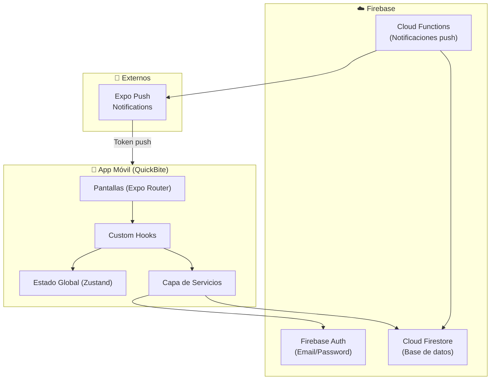
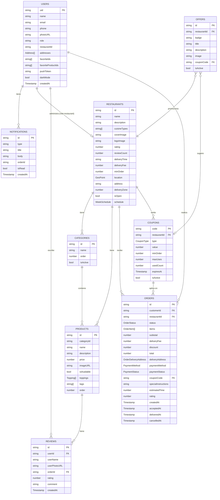
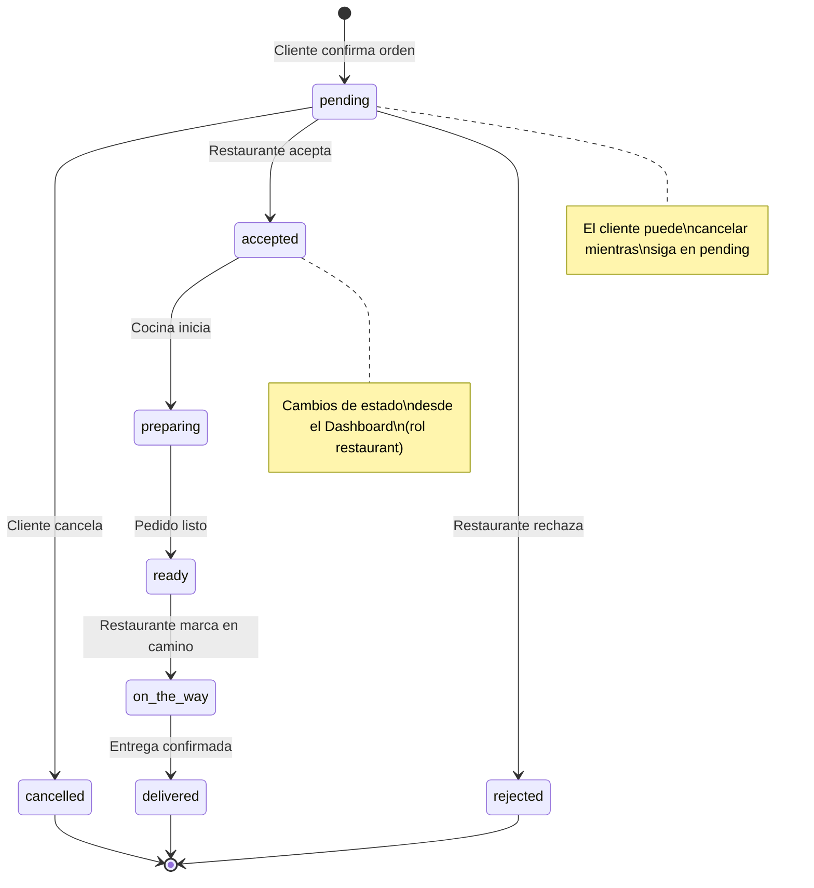
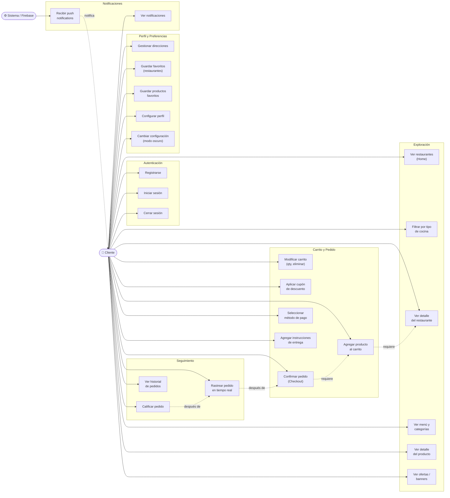
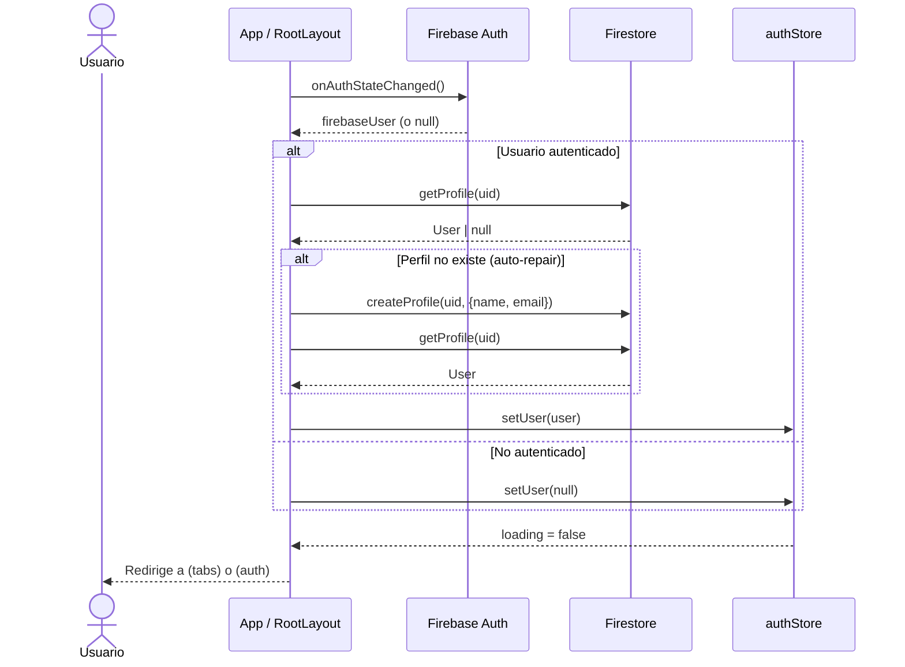
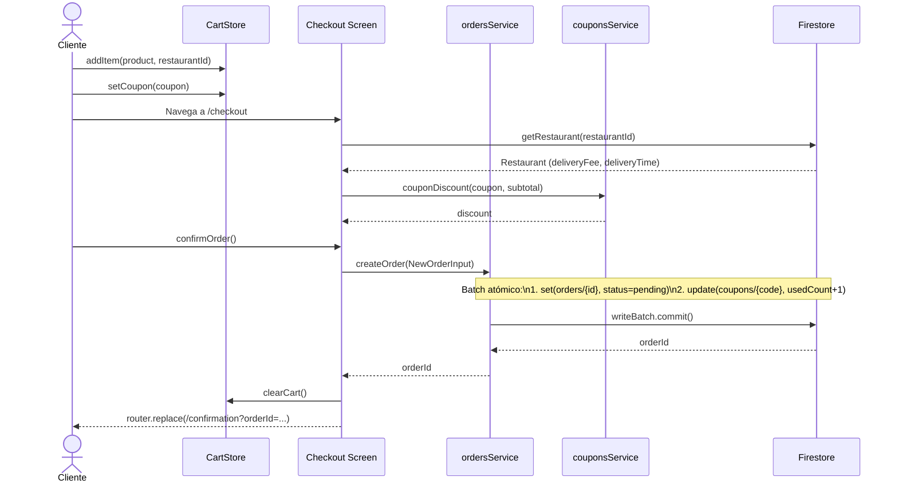
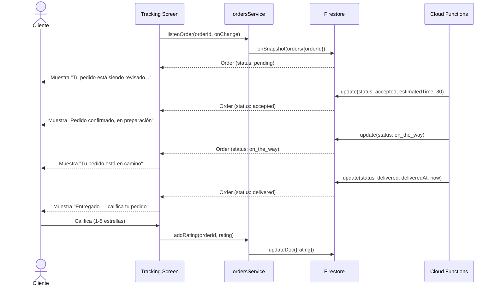
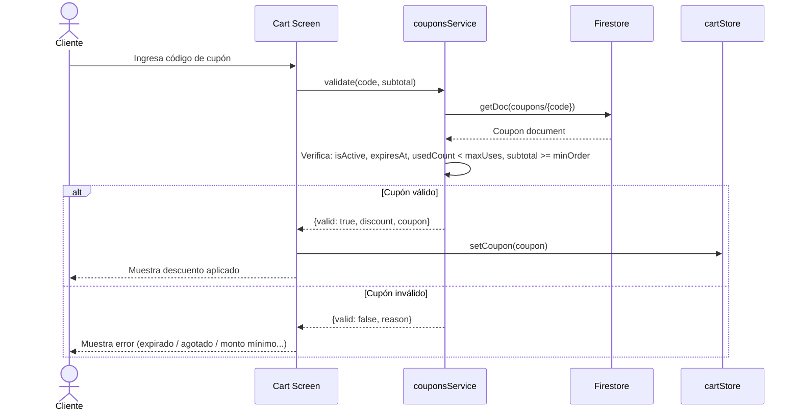
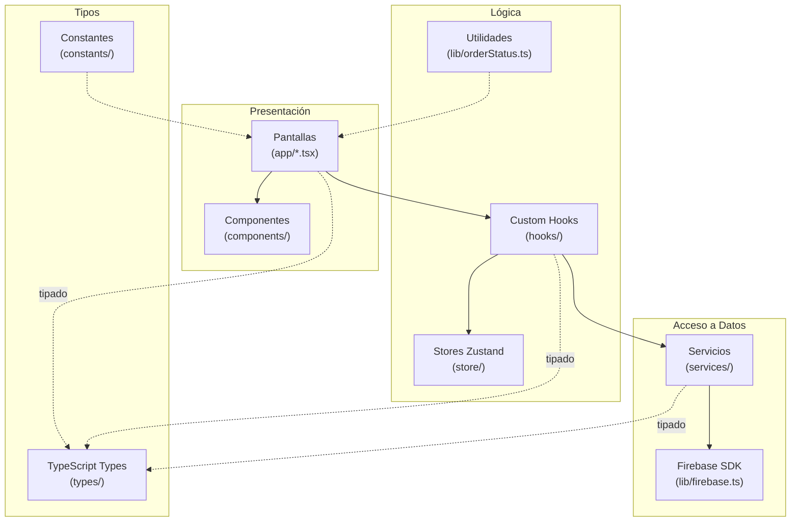

# QuickBite Mobile — Documentación Técnica

> **Estado del proyecto:** En desarrollo activo. Esta documentación refleja el estado actual y se actualizará conforme avance el desarrollo.

---

## Tabla de Contenidos

1. [Descripción General](#1-descripción-general)
2. [Stack Tecnológico](#2-stack-tecnológico)
3. [Arquitectura del Sistema](#3-arquitectura-del-sistema)
4. [Estructura del Proyecto](#4-estructura-del-proyecto)
5. [Modelo de Datos (Firestore)](#5-modelo-de-datos-firestore)
6. [Diagrama de Casos de Uso](#6-diagrama-de-casos-de-uso)
7. [Flujo de Navegación](#7-flujo-de-navegación)
8. [Diagramas de Secuencia](#8-diagramas-de-secuencia)
9. [Capas de la Aplicación](#9-capas-de-la-aplicación)
10. [Seguridad](#10-seguridad)
11. [Estado de Desarrollo](#11-estado-de-desarrollo)

---

## 1. Descripción General

**QuickBite** (`Tu comida, rápido.`) es una aplicación móvil de entrega de comida a domicilio. Permite a los usuarios explorar restaurantes, revisar menús, agregar productos al carrito, aplicar cupones de descuento, confirmar pedidos y rastrearlos en tiempo real.

Esta app es el **cliente móvil** (rol `customer`). El **Dashboard Web del restaurante** es un proyecto aparte que se autentica con **Firebase Auth** usando el rol `restaurant` y escribe directamente en Firestore, gobernado por las **Security Rules** (no con Admin SDK): gestiona su catálogo, actualiza el estado de los pedidos y administra sus cupones y ofertas. Las notificaciones push las crea Cloud Functions. **No existe un rol de repartidor**: el estado `on_the_way` lo asigna el propio restaurante.

### Actores del sistema

| Actor | Descripción |
|---|---|
| **Cliente (usuario)** | Persona que usa la app móvil para pedir comida (rol `customer`). |
| **Restaurante** | Dueño/staff del restaurante (rol `restaurant`). Se autentica con Firebase Auth y gestiona su catálogo, estados de pedido, cupones y ofertas desde el Dashboard Web (proyecto aparte). |
| **Sistema / Firebase** | Firebase Auth (identidad), Firestore (base de datos), Firebase Storage (imágenes) y Cloud Functions (notificaciones push). |

---

## 2. Stack Tecnológico

| Categoría | Tecnología | Versión |
|---|---|---|
| Framework base | React Native + Expo | `~54.0` |
| Enrutamiento | Expo Router | `~6.0` |
| Lenguaje | TypeScript | `~5.9` |
| Estilos | NativeWind (Tailwind CSS) | `^4.2` |
| Base de datos | Firebase Firestore | `^12.15` |
| Autenticación | Firebase Auth | `^12.15` |
| Almacenamiento de imágenes | Firebase Storage | `^12.15` |
| Persistencia local | AsyncStorage | `2.2.0` |
| Estado global | Zustand | `^5.0` |
| Notificaciones push | Expo Notifications | `~0.32` |
| Animaciones | React Native Reanimated | `~4.1` |
| Gestos | React Native Gesture Handler | `~2.28` |
| Iconos | Expo Vector Icons | `^15.0` |
| Imágenes | Expo Image | `~3.0` |
| Geolocalización | Expo Location | `~19.0` |
| Selección de imágenes | Expo Image Picker | `~17.0` |
| Fechas | date-fns | `^4.4` |

---

## 3. Arquitectura del Sistema



### Principios de arquitectura

La app sigue una arquitectura en capas con separación clara de responsabilidades:

**Presentación → Lógica → Datos**

- Las pantallas (Expo Router) son componentes React que consumen hooks personalizados.
- Los hooks encapsulan la lógica de negocio, estado local y efectos secundarios.
- Los servicios (`/services`) son módulos puros que hablan directamente con Firestore o Firebase Auth.
- El estado global (Zustand) se limita a dos stores: `authStore` (sesión) y `cartStore` (carrito en memoria).

---

## 4. Estructura del Proyecto

```
quickbite-mobile/
├── app/                        # Pantallas — rutas por convención de Expo Router
│   ├── _layout.tsx             # Root layout: inicializa Auth listener
│   ├── index.tsx               # Splash / redirección inicial
│   ├── (auth)/                 # Grupo de rutas no autenticadas
│   │   ├── login.tsx
│   │   └── onboarding.tsx
│   ├── (tabs)/                 # Barra de navegación inferior
│   │   ├── index.tsx           # Home
│   │   ├── favorites.tsx
│   │   ├── orders.tsx
│   │   └── profile.tsx
│   ├── restaurant/[id].tsx     # Menú del restaurante (ruta dinámica)
│   ├── product/[id].tsx        # Detalle del producto (ruta dinámica)
│   ├── cart.tsx
│   ├── checkout.tsx
│   ├── confirmation.tsx        # Post-pedido + calificación
│   ├── tracking.tsx            # Seguimiento en tiempo real
│   ├── notifications.tsx
│   └── settings.tsx
│
├── components/                 # Componentes reutilizables
│   ├── ui/                     # Componentes genéricos (Button, Input, Badge…)
│   ├── restaurant/             # RestaurantCard, CategoryFilter
│   ├── order/                  # CartItem, OrderCard, OrderStatusBadge
│   └── address/                # DeliveryAddressSheet
│
├── hooks/                      # Custom React Hooks
│   ├── useAuth.ts
│   ├── useCart.ts
│   ├── useFavorites.ts
│   ├── useLocation.ts
│   ├── useNotifications.ts
│   ├── useOffers.ts
│   ├── useOrders.ts
│   ├── useProduct.ts
│   ├── useRestaurant.ts
│   └── useRestaurants.ts
│
├── services/                   # Acceso a Firebase (Firestore + Auth + Storage)
│   ├── auth.service.ts
│   ├── coupons.service.ts
│   ├── notifications.service.ts
│   ├── offers.service.ts
│   ├── orders.service.ts
│   ├── restaurants.service.ts
│   ├── reviews.service.ts      # Reseñas de producto
│   ├── storage.service.ts      # Subida de imágenes a Firebase Storage
│   └── users.service.ts
│
├── store/                      # Estado global (Zustand)
│   ├── authStore.ts
│   └── cartStore.ts
│
├── types/                      # Definiciones TypeScript
│   ├── coupon.types.ts
│   ├── navigation.types.ts
│   ├── notification.types.ts
│   ├── offer.types.ts
│   ├── order.types.ts
│   ├── product.types.ts
│   ├── restaurant.types.ts
│   ├── review.types.ts
│   └── user.types.ts
│
├── constants/
│   ├── colors.ts
│   └── config.ts               # Timeouts, límites, textos globales
│
├── lib/
│   ├── firebase.ts             # Inicialización de Firebase App/Auth/Firestore/Storage
│   ├── notifications.ts        # Handler de push (foreground) y canal Android
│   └── orderStatus.ts          # Etiquetas y colores de estados de pedido
│
├── firestore.rules             # Reglas de seguridad de Firestore
├── storage.rules               # Reglas de seguridad de Firebase Storage
└── scripts/
    ├── seed.mjs                # Script de datos de prueba
    └── seed-data.json
```

---

## 5. Modelo de Datos (Firestore)

Firestore organiza los datos en las siguientes colecciones y subcolecciones:



> **Reseñas de producto:** viven en la subcolección `restaurants/{restId}/products/{prodId}/reviews/{userId}` (el ID del documento es el `uid` del autor → una reseña por usuario y producto). Solo puede reseñar quien tiene un pedido `delivered` propio que incluya el platillo (compra verificada). No hay promedio agregado en el producto.

### Imágenes y Firebase Storage

Los campos de imagen (`coverImage`, `logoImage`, `imageURL`, `photoURL`, `offers.image`) son **URLs**. Pueden ser externas o URLs de descarga de **Firebase Storage**. La foto de perfil del cliente se sube a Storage desde la app (`users/{uid}/avatar_<timestamp>.jpg`); el Dashboard sube las imágenes del restaurante a `restaurants/{restId}/**` y `offers/{restId}/**`. El bucket del proyecto es `gs://quickbite-6dee7`.

### Estados del pedido



> **Notas:**
> - El cliente solo puede crear el pedido en `pending` y, mientras siga en `pending`, **cancelarlo** (`cancelled`). Después ya no puede cambiar el estado (salvo su calificación al entregarse).
> - `rejected` lo pone el restaurante; `cancelled` lo pone el cliente. Son estados distintos.
> - Del `accepted` en adelante, los cambios los hace el **Dashboard Web** (rol `restaurant`) directamente sobre Firestore. **No hay repartidor**: `on_the_way` lo marca el restaurante.

---

## 6. Diagrama de Casos de Uso



---

## 7. Flujo de Navegación

```mermaid
flowchart TD
    Start([Inicio App]) --> Index[app/index.tsx\nSplash / Redirect]

    Index --> AuthCheck{¿Sesión\nactiva?}

    AuthCheck -->|No| Auth["(auth)"]
    Auth --> Login[login.tsx]
    Auth --> Onboarding[onboarding.tsx]

    AuthCheck -->|Sí| Tabs["(tabs) — Nav inferior"]

    Tabs --> Home["index.tsx\nHome"]
    Tabs --> Favs[favorites.tsx]
    Tabs --> Orders[orders.tsx]
    Tabs --> Profile[profile.tsx]

    Home --> RestDetail[restaurant/[id]\nDetalle + Menú]
    RestDetail --> ProdDetail[product/[id]\nDetalle + Toppings]
    ProdDetail --> Cart[cart.tsx]

    Cart --> Checkout[checkout.tsx\nPago + Dirección]
    Checkout --> Confirmation[confirmation.tsx\nPost-pedido]
    Confirmation --> Tracking[tracking.tsx\nSeguimiento RT]

    Orders --> Tracking

    Profile --> Settings[settings.tsx]
    Tabs --> Notifs[notifications.tsx]

    style Auth fill:#ffeaa7
    style Tabs fill:#dfe6e9
    style Tracking fill:#00b89420,stroke:#00b894
```

---

## 8. Diagramas de Secuencia

### 8.1 Autenticación y carga de perfil



### 8.2 Flujo completo de pedido



### 8.3 Seguimiento de pedido en tiempo real



### 8.4 Validación y aplicación de cupón



---

## 9. Capas de la Aplicación

### Diagrama de capas



### Descripción de cada capa

**Presentación** — Las pantallas son componentes React funcionales. No contienen lógica de negocio; delegan en hooks. Los componentes en `/components` son reutilizables y reciben sus datos por props.

**Lógica** — Los custom hooks coordinan efectos, llamadas a servicios y actualizaciones de estado. Los stores Zustand (`authStore`, `cartStore`) guardan estado global de sesión y carrito respectivamente.

**Acceso a Datos** — Los servicios son módulos con funciones puras que usan el SDK de Firebase. No tienen estado propio. La regla es: una función de servicio = una operación de Firestore o Auth.

**Tipos** — Todas las entidades del sistema están tipadas en `/types`. Los tipos coinciden exactamente con la estructura de los documentos en Firestore.

---

## 10. Seguridad

Las reglas de Firestore (`firestore.rules`) implementan el principio de mínimo privilegio para el cliente móvil:

| Colección | Cliente (`customer`) | Restaurante (`restaurant`) |
|---|---|---|
| `users/{uid}` | Leer/editar el propio perfil (campos permitidos) | Igual, su propio perfil |
| `users/{uid}/notifications` | Leer y marcar `isRead = true` | N/A |
| `restaurants/**` | Solo lectura | Lectura y escritura de **su** restaurante (`restaurantId`) |
| `offers` | Solo lectura | Crear/editar/borrar las de su restaurante |
| `coupons` | Leer + incrementar `usedCount` en 1 | Crear/editar/borrar los de su restaurante |
| `orders` | Crear con `status=pending`; cancelar mientras esté `pending`; editar su `rating` | Leer y avanzar `status`/`estimatedTime` de sus pedidos |
| `products/{id}/reviews/{uid}` | Crear/editar la propia con compra verificada (`orderId` de un pedido `delivered` suyo) | Solo lectura |

**Storage** (`storage.rules`): `users/{uid}/**` lo escribe cada usuario; `restaurants/{restId}/**` y `offers/{restId}/**` solo el restaurante dueño; lectura para cualquier usuario autenticado.

### Campos protegidos del perfil de usuario

El cliente **solo puede editar** estos campos de su documento `/users/{uid}`:
`name`, `phone`, `photoURL`, `addresses`, `favoriteIds`, `favoriteProductIds`, `darkMode`, `pushToken`

Los campos `role`, `restaurantId`, `email` y `createdAt` son inmutables desde la app móvil. El autoregistro fuerza `role='customer'`; las cuentas `restaurant` se provisionan por fuera del cliente.

---

## 11. Estado de Desarrollo

> El proyecto está en desarrollo activo. La tabla a continuación refleja el estado estimado al momento de esta documentación.

### Pantallas y flujos

| Funcionalidad | Estado |
|---|---|
| Autenticación (login / registro) | ✅ Implementado |
| Onboarding | ✅ Implementado |
| Home — lista de restaurantes | ✅ Implementado |
| Home — filtro por tipo de cocina | ✅ Implementado |
| Home — banners de ofertas | ✅ Implementado |
| Detalle de restaurante + menú | ✅ Implementado |
| Detalle de producto + toppings | ✅ Implementado |
| Carrito | ✅ Implementado |
| Validación y aplicación de cupones | ✅ Implementado |
| Checkout | ✅ Implementado |
| Confirmación de pedido | ✅ Implementado |
| Seguimiento en tiempo real | ✅ Implementado |
| Calificación de pedido | ✅ Implementado |
| Historial de pedidos | ✅ Implementado |
| Favoritos (restaurantes) | ✅ Implementado |
| Favoritos (productos) | ✅ Implementado |
| Notificaciones in-app | ✅ Implementado |
| Notificaciones push (Expo) | ✅ Implementado |
| Banner de notificación en primer plano | ✅ Implementado |
| Gestión de direcciones | ✅ Implementado |
| Configuración / perfil | ✅ Implementado |
| Foto de perfil (subir a Storage) | ✅ Implementado |
| Modo oscuro | ✅ Implementado |
| Internacionalización (ES/EN) | ✅ Implementado |
| Cancelación de pedido (cliente) | ✅ Implementado |
| Reordenar (rellenar carrito) | ✅ Implementado |
| Reseñas de producto | ✅ Implementado |
| Pasarela de pago real | ⏳ Pendiente |
| Dashboard Web del restaurante | 🔄 En desarrollo (proyecto aparte) |

### Limitaciones conocidas (técnicas)

- El filtrado de restaurantes y pedidos se hace **en cliente** (se descarga toda la colección y se filtra en memoria). Para volúmenes grandes se recomienda migrar a queries de Firestore con índices compuestos.
- El sistema de pago es simulado (`paymentStatus: 'pending'`). No hay integración con pasarela real aún.
- Las **reseñas de producto** verifican la compra parcialmente en reglas: se comprueba que el `orderId` sea un pedido `delivered` del usuario, pero no que el producto esté en ese pedido (las reglas no recorren el array `items`); eso lo garantiza el cliente.
- El reorder usa el **menú actual** del restaurante (precios/imágenes vigentes) y omite platillos no disponibles.
- Las Cloud Functions (cambio de estado de pedido, envío de push) están fuera del alcance de este repositorio.

---

*Documentación actualizada el 2026-07-03. Actualizar con cada iteración significativa del proyecto.*
