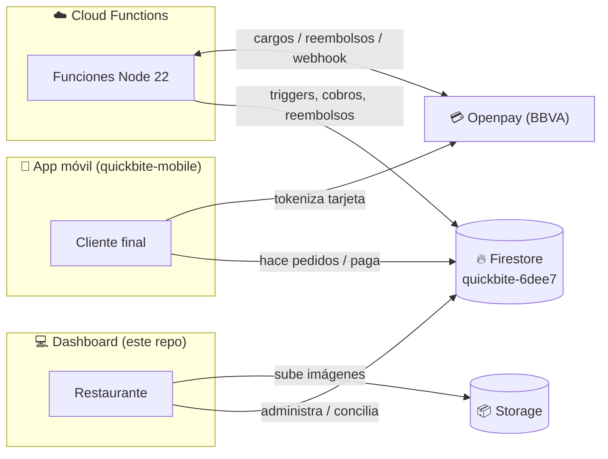
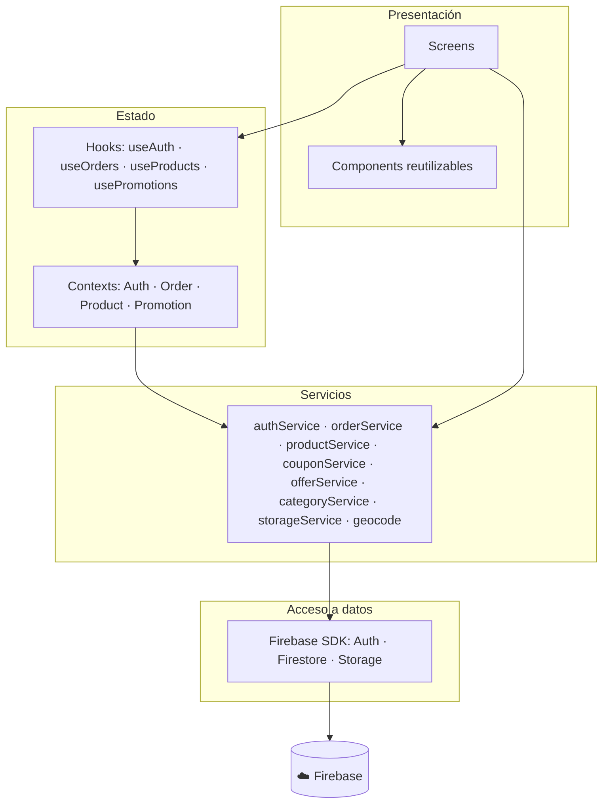
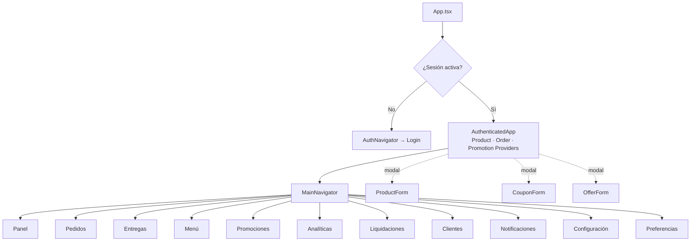
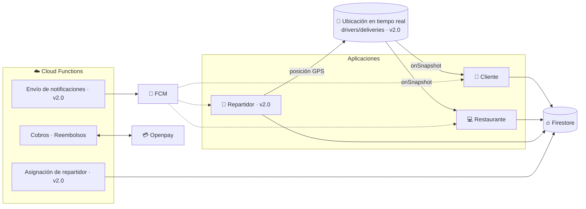

# Arquitectura

Este documento describe la arquitectura **actual (v1.0)** del dashboard y la
**arquitectura objetivo (v2.0)** hacia la que evoluciona el sistema (app de
repartidor, GPS en tiempo real y notificaciones push).

---

## 1. Estilo arquitectónico

Aplicación **cliente-servidor serverless**:

- **Frontend** con arquitectura **por capas** (presentación → estado → servicios → SDK).
- **Backend orientado a eventos**: Cloud Functions activadas por triggers de Firestore y por llamadas callable/HTTP.
- **Estado global** con **React Context** (patrón Provider); la lógica de datos se aísla en una **capa de servicios**.
- **Base de código única** Expo, ejecutable en **web** (el dashboard) y **nativo**.

---

## 2. Actores y roles

| Actor | Rol (`users.role`) | Acceso | Descripción |
|---|---|---|---|
| **Cliente final** | `customer` | App móvil | Explora, pide y paga. No entra al dashboard. |
| **Restaurante** | `restaurant` | Dashboard | Opera todo el portal sobre su propio `restaurantId`. |
| **Administrador** | — (consola) | Firebase Console | Aprovisiona cuentas de restaurante manualmente (ver [authentication.md](authentication.md)). No es un rol dentro de la app. |
| **Sistema** | — | Cloud Functions | Cobra, reembolsa, notifica y recalcula agregados. |
| **Repartidor** *(v2.0)* | `driver` *(planeado)* | App Driver | Acepta entregas, comparte ubicación y actualiza estados. Aún no implementado. |

---

## 3. Arquitectura actual (v1.0)

### 3.1 Vista de sistema



### 3.2 Capas del dashboard



**Principios**

- Las pantallas **no** llaman a Firestore directamente: usan servicios o contextos.
- **Fuente única de verdad** de la sesión: `AuthContext`.
- **Tiempo real por suscripción**: `OrderContext` escucha los pedidos con `onSnapshot`.
- **Confianza cero en el cliente**: los montos de cobro se recalculan en Cloud Functions.

### 3.3 Navegación



La barra lateral (`Sidebar`) se renderiza como **rail fijo** cuando el ancho ≥ 960 px
y como **drawer** deslizable en pantallas menores.

---

## 4. Arquitectura objetivo (v2.0)

La evolución añade **reparto en tiempo real**. Tres capacidades nuevas:

1. **App de repartidor** (`QuickBite Driver`) — nueva app/módulo Expo con rol `driver`.
2. **GPS y tiempo real** — el repartidor comparte su ubicación; el cliente y el dashboard la ven en un mapa.
3. **Notificaciones push (FCM)** — eventos del ciclo del pedido para cliente, restaurante y repartidor.

### 4.1 Vista de sistema objetivo



*(Los nodos marcados **v2.0** son nuevos respecto a la arquitectura actual.)*

### 4.2 Impacto por área

| Área | Cambio v2.0 |
|---|---|
| **Roles** | Nuevo rol `driver` en `users.role`; perfil de repartidor (vehículo, disponibilidad). |
| **Datos** | `orders` gana `driverId` y estados de asignación; canal de ubicación en tiempo real. Ver [database.md](database.md#4-extensiones-planeadas-v20). |
| **Dashboard** | La pantalla **Entregas** pasa de solo-lectura a **asignar y seguir** repartidores en un mapa. |
| **Backend** | Función de **asignación** de repartidor; funciones de **envío de notificaciones** (FCM). |
| **Seguridad** | Reglas: el repartidor solo ve/actualiza los pedidos que le fueron asignados y su propia ubicación. |

### 4.3 Orden de evolución

```
Estabilizar → Documentar → Asegurar → Driver → GPS → Notificaciones → Testing → CI/CD
   (hecho)      (aquí)       (hecho)   (v2.0)  (v2.0)    (v2.0)        (hecho)  (hecho)
```

> Decisiones de diseño que sustentan esta arquitectura (Firebase, Context vs Redux,
> single-merchant Openpay, canal de ubicación, etc.) en [decisions.md](decisions.md).
