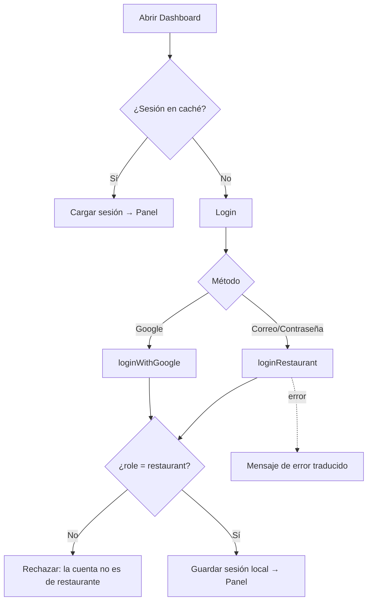

# Autenticación y autorización

## 1. Métodos

El dashboard usa **Firebase Authentication** con dos métodos:

- **Correo / contraseña** — `loginRestaurant`, `registerRestaurant`.
- **Google** — `loginWithGoogle` (web: popup de Firebase) / `loginWithGoogleIdToken` (nativo, vía `expo-auth-session`).

Las contraseñas las gestiona **Firebase Auth** (no se cifran ni almacenan a mano).
La recuperación de contraseña usa `sendRestaurantPasswordReset`.

## 2. Roles y control de acceso

El rol vive en `users/{uid}.role` (ver [database.md](database.md)):

| Rol | Puede |
|---|---|
| `restaurant` | Entrar al dashboard y administrar **solo** su `restaurantId`. |
| `customer` | Nada en el dashboard (es de la app móvil). El login lo **rechaza** si el rol no es `restaurant`. |

La autorización efectiva se aplica en el servidor con **Firestore Security Rules**
(el frontend solo decide qué mostrar). Ver [deployment.md](deployment.md) y
[`firestore.rules`](../firestore.rules).

Los errores de Firebase se traducen a mensajes en español con
[`getAuthErrorMessage` / `getErrorMessage`](../src/utils/validation.ts).

## 3. Sesión

- Fuente única de verdad: **`AuthContext`** (usuario + restaurante).
- Persistencia local con **AsyncStorage** según la opción **"recordar dispositivo"**
  (claves en [`STORAGE_KEYS`](../src/utils/constants.ts)); `loadSession` la restaura al abrir.
- `logoutRestaurant` cierra sesión y limpia el cache local.

## 4. Aprovisionamiento de cuentas de restaurante

> ⚠️ El dashboard es **solo-login**: **no** hay auto-registro público de restaurantes
> en producción. El administrador crea cada cuenta manualmente en la **Firebase Console**:
>
> 1. Crear el usuario en **Authentication**.
> 2. Crear `users/{uid}` con `role: "restaurant"` y `restaurantId`.
> 3. Crear el documento `restaurants/{restaurantId}`.
>
> Esto evita que cualquiera se auto-asigne el rol `restaurant`. El flujo de registro
> del código existe para desarrollo/pruebas, pero el modelo de operación es
> aprovisionamiento por consola.

## 5. Verificación de correo

En la **app móvil** el registro bloquea el acceso hasta verificar el correo
(estricto, solo para clientes). En el **dashboard**, al ser cuentas aprovisionadas
por un administrador, no se exige ese paso.
