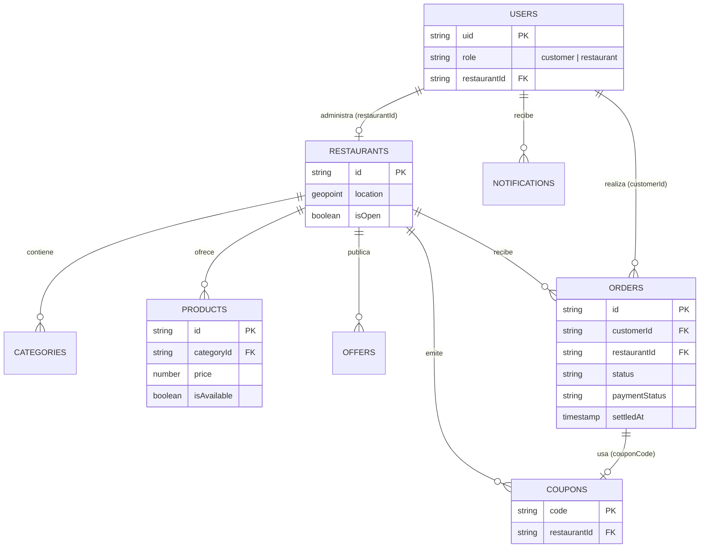
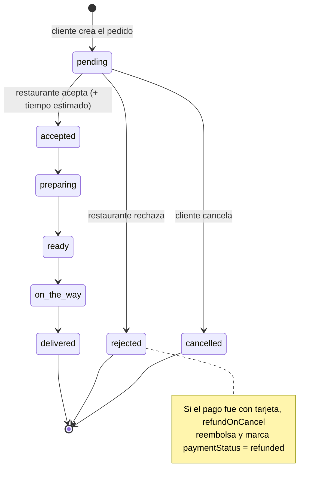

# Modelo de datos

Base de datos **NoSQL documental** (Cloud Firestore, proyecto `quickbite-6dee7`).
No hay JOINs: las relaciones se expresan por **referencias de ID**. Los nombres de
colección están centralizados en [`src/utils/constants.ts`](../src/utils/constants.ts).

---

## 1. Diagrama entidad-relación



---

## 2. Colecciones

```
users/{uid}
restaurants/{restId}
  ├── categories/{categoryId}      (subcolección)
  └── products/{productId}         (subcolección)
orders/{orderId}
coupons/{code}                     (el código ES el ID del documento)
offers/{offerId}
users/{uid}/notifications/{notifId}   (subcolección; las crea Cloud Functions)
```

### `users/{uid}` — perfil de cliente o restaurante
| Campo | Tipo | Notas |
|---|---|---|
| uid | string | = `auth.uid` |
| name, email | string | — |
| phone, photoURL | string? | opcionales |
| role | `customer` \| `restaurant` | define permisos |
| restaurantId | string? | solo si `role = restaurant` → FK a `restaurants` |

### `restaurants/{id}` — datos del negocio
| Campo | Tipo | Notas |
|---|---|---|
| name, description | string | — |
| cuisineTypes | string[] | tipos de cocina (filtro del cliente) |
| coverImage, logoImage | string | URLs de Storage |
| deliveryFee, minOrder | number | usados en el checkout |
| location | GeoPoint | geocodificado desde la dirección |
| deliveryZone | number | radio de cobertura (km) |
| isOpen | boolean | interruptor manual |
| autoSchedule | boolean | `true` = respeta `schedule`; `false` = usa `isOpen` |
| schedule | WeekSchedule | horario por día |

### `restaurants/{id}/products/{prodId}` — platillos
| Campo | Tipo | Notas |
|---|---|---|
| categoryId | string | FK a `categories` |
| price | number | precio unitario |
| isAvailable | boolean | visible al cliente |
| toppings | Topping[] | grupos de opciones |
| rating, reviewCount | number | calculado por Cloud Function (solo lectura) |

### `orders/{orderId}` — núcleo transaccional
| Campo | Tipo | Notas |
|---|---|---|
| customerId, restaurantId | string | FKs |
| items | OrderItem[] | líneas del pedido |
| subtotal, deliveryFee, discount, total | number | recalculados en servidor al pagar |
| status | OrderStatus | ver §3 |
| paymentMethod | `card` \| `cash` \| ~~`paypal`~~ | paypal deshabilitado |
| paymentStatus | `paid` \| `pending` \| `failed` \| `refunded` | independiente de `status` |
| paymentProvider | `openpay`? | solo tarjeta |
| openpayChargeId | string? | id del cargo (conciliar/reembolsar) |
| cardBrand, cardLast4 | string? | para mostrar |
| paidAt, refundedAt, settledAt | timestamp? | pago / reembolso / **liquidación** |
| couponCode | string \| null | FK a `coupons` |
| rejectionReason | string? | lo escribe el restaurante al rechazar |
| estimatedTime | number? | minutos, al aceptar |
| customerName, customerPhone | string? | denormalizados por la app cliente |

### `coupons/{code}` — el código es el ID
| Campo | Tipo | Notas |
|---|---|---|
| restaurantId | string | dueño; el cupón solo aplica aquí |
| type | `percent` \| `fixed` | — |
| value, minOrder, maxUses, usedCount | number | `maxUses ≥ 1` (validado en el form) |
| expiresAt | Date \| null | null = sin vencimiento |
| isActive | boolean | — |

### `offers/{offerId}` — banners promocionales del Home móvil
Tres tipos (`type`): `banner`, `coupon` (banner + cupón vinculado), `dish` (banner
ligado a un platillo). Campos de vigencia `startsAt`/`endsAt` opcionales.

---

## 3. Ciclo de vida del pedido

Valores de `status` en [`ORDER_STATUS`](../src/utils/constants.ts):



El **estado de pago** (`paymentStatus`) es **independiente** del estado del pedido
(`status`): un pedido puede estar `delivered` con pago `paid`, o `rejected` con
pago `refunded`.

---

## 4. Extensiones planeadas (v2.0)

Para el reparto en tiempo real (ver [architecture.md](architecture.md#4-arquitectura-objetivo-v20)).
**Aún no implementado** — propuesta de modelo:

| Entidad | Cambio |
|---|---|
| `users.role` | Añadir valor `driver`. |
| `users/{uid}` (driver) | `vehicle`, `isAvailable`, `currentLocation` (GeoPoint), token FCM. |
| `orders/{orderId}` | `driverId` (FK), `assignedAt`, y estados de asignación de la entrega. |
| **Ubicación en vivo** | Canal de alta frecuencia para la posición del repartidor durante la entrega (documento por entrega o Realtime Database). La decisión de tecnología se registra en [decisions.md](decisions.md). |

> **Privacidad**: la ubicación del repartidor se guarda **solo mientras hay una
> entrega activa** y se purga al completarla.
